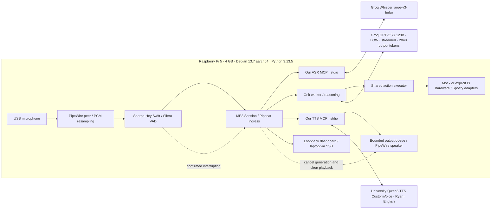

# ME3 — Swift: two-page report content

Evidence cutoff: 2026-11-06. Prepared against `machine_exercise_2page.pdf`; this Markdown is content for the supplied layout, not a claim of a two-page typeset PDF. Values marked unavailable must remain so until measured. Pi findings below were supplied by the deployment operator.

## 1. System diagram

Pi software startup is verified; this complete physical audio path is not yet exercised. Pi-side university VPN routing is required for TTS. Browser/laptop testing instead uses browser capture/playback with the same bridge/Session. Input can remain active during output; amplitude alone is not a confirmed interruption.

## 2. Versioned prompt

The authoritative worker instructions are versioned in `src/me3_voice/onit_worker.py`; contextual request construction is in `onit_tasks.py`. Actual excerpt: “You are Swift's confined task worker.” / “Complete the user's request using only the available scoped tools.” The project-only branch asks for complete flat files and explicitly forbids claiming run/test/deployment. `SWIFT_ENGLISH_OUTPUT_POLICY` controls English spoken output. These are conditional instructions, not one universal prompt. A universal two-sentence limit, blanket approval workflow, prompt caching and human-like prosody are not demonstrated. Stop/cancellation is enforced by Session, not reliance on a model instruction.

## 3. Context engineering

Model input includes bounded recent user/assistant turns plus structured task receipts and selected correction references. Raw VAD events and audio are not automatically LLM messages. ASR is final-only with the selected Whisper file API: do not claim streaming partial recognition. Context is deterministically reduced without a summarization model call; oversized essential context produces a recoverable error. User corrections and uncertain task outcomes must survive reduction. Visible transcript, in-process model context and opt-in durable receipts have different lifetimes. Browser reconnect does not restore chat; receipts do not rearm timers. No RAG/vector database or provider prefix-cache benefit is established. Session/turn identities fence cancelled output; completed effects are not rerun for speech recovery.

## 4 + 6. MCP services and serving

| Component | Actual contract | Serving / evidence |
|---|---|---|
| ASR | Our stdio MCP: `asr_start`, `asr_append`, `asr_finish`, `cancel` | Pi subprocess startup verified; Groq Whisper remotely hosted. Historical synthetic live replay exists; current Pi inference unverified. |
| TTS | Our stdio MCP: `tts_start`, `tts_next`, `cancel` | University Qwen3-TTS chunks resampled to16 kHz. Pi startup verified; Pi provider auth/audio unverified. |
| Harness/LLM | Installed Onit0.1.5a0, pin3d014cf; scoped tool registry and configured API | Pi worker READY/imports passed with dummy key, no Pi model task. Historical Groq120B website output verified on HPC. Transitive Onit packages frozen, not fully locked. |
| VAD/wake | In-process Silero16 kHz / pretrained Sherpa configurable keywords | Pi one-second synthetic-silence replay passed; no Pi real-speaker accuracy. |
| Actions | Typed in-process executor, mock/Pi/Spotify adapters | Lights, display setpoint, timers/alarms, time/weather/reminders; bounded phone adapters require permissions. Physical effects pending. **No separate task MCP server: clarify template's task-tool-MCP expectation.** |

## 5. Evaluation, demo and results

Pi locked install/check, demo retry,10 mock scenarios, wake assets, silence replay and mock loopback health passed. First MCP initialization timed out; cause remains unknown. USB devices detected, no capture/playback. One VPN session connected; university TTS/Groq TCP checks43/136 ms, then VPN disconnected. These are routing checks, not inference/voice timing.

| Required metric | Current defensible result |
|---|---|
| End-of-speech → audible response, mean/p95 | Unavailable on Pi; no acoustic capture. Endpoint→packet is a separate software proxy. |
| ASR final, LLM TTFT, TTS first chunk | Historical per-run software evidence exists; no matched current Pi N×M distribution. First speakable text is not necessarily first token. |
| Barge-in → physical silence | Unavailable; software stop dispatch does not measure speaker silence. |
| WER | No frozen Pi test-set run; synthetic exact matches are not a real-speaker WER estimate. |
| Class benchmark | Latest reviewed revision9d7a824; official launcher READY and active/inactive real-transport mock checks passed. No valid complete run; trial activation/isolation remains a gate. |

Historical Groq120B LOW/streamed project trials: three independently checked generations, median5.297 s task completion; this is not conversation or audible latency. The earlier university-backed class single-clip trial missed its8 s response window; its run does not qualify the newer Groq profile.

Historical laptop observations support audibility for particular trials, usable task routing and some quiet/music-only periods without false bubbles. They also report difficult waking over loud music, unintended interruption, nonpersistent volume, ASR errors and TTS laughter. They do not qualify Pi acoustics or show all defects resolved.

Proposed 2–3 minute demo after qualification: wake + factual answer → light command and observed LED → follow-up correction → short website through Onit with inspected file/counter/download → intentional interruption → bounded service failure and next-turn recovery. Before claiming success: Pi-side auth/inference, real mic/speaker, meaningful task MCP interpretation, complete per-trial benchmark isolation, measured timing distributions and physical ME2 outputs. Record cooling, network, date, model IDs, cold/warm state, trial counts and failures; keep unavailable metrics visible. Primary references: supplied template, docs/ARCHITECTURE.md, docs/BENCHMARK.md, docs/PLAN.md and the class benchmark source.
