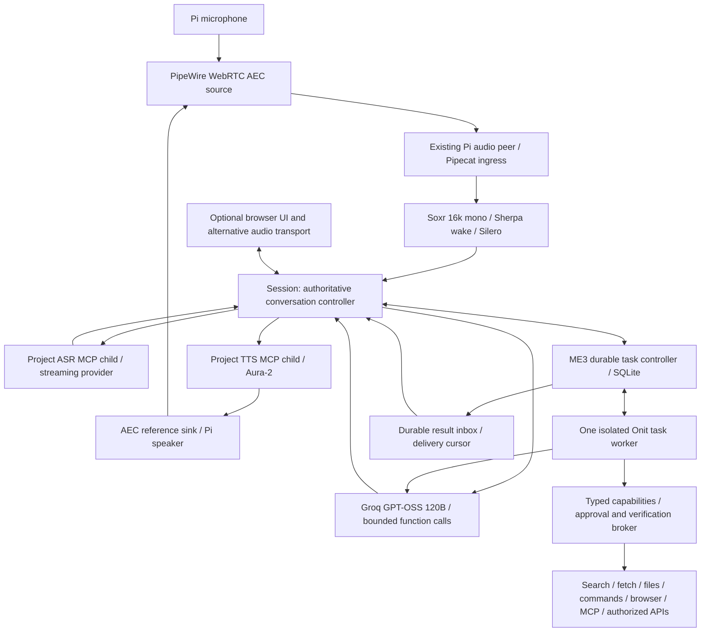

# Phase 1 — proposed architecture and decisions

> **CURRENT FINAL TARGET:** [PHASE1_REDUNDANCY_ELIMINATION.md](PHASE1_REDUNDANCY_ELIMINATION.md). Pipecat-native conversation replaces Session/narrow ingress/custom voice tool and playback loops. One LangGraph worker with native checkpoints/interrupts replaces Onit and the proposed custom task executor. Keep functional speech MCP services through thin native service adapters, one PipeWire I/O adapter, and ME3 permission/effect verification. New dependency/ARM64/SQLite proofs remain required. Prior recommendations below are historical and do not govern implementation.

> SUPERSEDED historical challenge decision: [PHASE1_SIMPLIFICATION_DECISION.md](PHASE1_SIMPLIFICATION_DECISION.md) was the intermediate convergence decision. Its Session/custom-step-executor selection is superseded by the redundancy correction. Voice remains simplified Session + narrow Pipecat; speech/model primaries remain provisional. The future task target is one ME3 model-step executor plus SQLite controller, with replacement of Onit gated by Phase 5 parity/recovery tests. No runtime migration has occurred. Strict Groq response-schema mode must not be assumed to work with streamed tool calls. Native Pi base application process count is seven, correcting the earlier arithmetic.

Decision date: 2026-11-09. Design checkpoint complete; implementation starts only after authorization of the applicable next phase. Phase 0 remains the baseline. No new model, audio, resource, or task benchmarks were performed. Account access and regional availability were not tested. All selections below are provisional deployment recommendations until their acceptance gates pass.

## Proposed topology

The task controller is an ME3 module inside the bridge process, not another daemon or LLM. The worker plans dynamically and executes one bounded step at a time. Session remains responsive while the worker runs. The controller exclusively owns task identity, requirements revisions, approvals and persistent lifecycle. Onit owns ephemeral planning/model context inside the task; it does not become the conversation controller or an alternative durable ledger.

## Before/after tooling matrix and bounded options

| Boundary and existing limitation | Preferred choice | Alternative considered / reason deferred | Validation and rollback |
|---|---|---|---|
| Native capture/playback exists; no Pi AEC | Existing PipeWire with `libpipewire-module-echo-cancel`, `aec/libspa-aec-webrtc`; explicit virtual capture source and reference playback sink. Use native 48 kHz devices and a single Soxr conversion to model 16 kHz. | Hardware AEC only if controlled software trials fail; no purchase recommendation yet. Separate Python AEC adds timing/reference plumbing. | Inspect installed Pi PipeWire/plugin version first; current upstream docs describe 1.6.11, not the Pi version. Capture/render/double-talk trials in Phase 2; unload only ME3-owned nodes to roll back. |
| Wake alternatives and overlapping frontend state | Sherpa-ONNX 2.0.1 existing GigaSpeech 3.3M Hey Swift assets; Silero from Pipecat 1.13.0. Session is the sole accepted-turn authority; ConversationInput supplies onset/end proposals, FrontendMonitor diagnostics only. | openWakeWord 0.6.0 stays a controlled comparison, not a second simultaneous detector. | Freeze assets/hash; misses/false wakes and contention gate. Preserve current profile for rollback. |
| Fixed 1.024 s endpoint | Keep fixed policy for Phase 2 baseline; preferred optimization is bundled `LocalSmartTurnAnalyzerV3`, one CPU thread, off-loop inference, bounded fixed-silence fallback. | Flux English streaming has model-native endpointing and requires a v2 event adapter. Do not run its turn authority alongside Smart Turn; consider only if Nova/local endpoint combination fails. | Phase 3 paired pause/correction trials; ship Smart Turn only if premature-end and lag gates pass. Fall back to fixed silence. |
| 32 ms MCP RPCs and awaited receive handler | Preserve MCP 2.3.0 ASR/TTS stdio children. Version speech contract to accept bounded 96 ms ASR batches, retain original sample offsets; TTS remains pull/backpressured initially. Separate receive/control pump from bounded input processing. | Binary side channel adds connection and course interpretation cost; reject for baseline. Avoid speculative removal of MCP. | Compare 32 vs 96 ms, p95 overhead and input/control lag. Flush remaining PCM at endpoint; existing contract remains rollback option. |
| Final-only Qwen ASR | Deepgram `nova-3`, language `en`, streaming `/v1/listen` with interim results; Session commits on its own endpoint plus explicit provider finalize. | Flux adds turn authority/API migration. Groq Whisper remains a final-only degraded speech option. | Existing Deepgram adapter still needs contract/cancellation/finalization tests. One final per turn; reconnect only future turns, never silently resend prior speech. |
| University TTS/network dependency | Deepgram `aura-2-thalia-en`, `/v1/speak` WebSocket, PCM16/16 kHz; server-owned connection, explicit flush/clear and generation fencing. | Local Piper only as a gated outage option; university Qwen remains experimental. | Reuse connections only after proving Clear cannot leak earlier output. Close/reopen on uncertainty. Preserve current providers as explicit profiles. |
| Optional synchronous Onit task blocks model-requiring follow-ups | Retain installed Onit 0.1.5a0 at recorded source pin `3d014cfae043130d956ac042de7142516146e96b`, behind ME3 start/step/checkpoint/control adapter and one isolated worker. | Focused LangGraph graph with SQLite checkpointer if bounded step/steer/recovery cannot be integrated cleanly. Deep Agents adds unnecessary filesystem/subagent policy for initial migration. | Phase 5 prototype must show stop-before-tool and requirement revision fencing. Do not ship custom checkpoint internals that cannot be tested. Same Task API permits backend rollback. |
| Research optional; no evidence pipeline | Tavily Basic search plus bounded aiohttp HTTP retrieval and standard HTML extraction (`html.parser` initially). Typed source records and deterministic verification. | Browser only for pages requiring interaction; no vector DB or separate search agent. | Preserve URLs, retrieved/published dates, quotes/hash, claims; test redirects/private-network rejection and prompt injection. |
| Selected durable receipts, no general tasks | Python stdlib SQLite WAL, one writer off voice loop; task/event/approval/step/effect/outbox records with explicit schema migrations. | LangGraph checkpoint DB cannot substitute for authoritative approvals/effect journal. Avoid Redis/Postgres on Pi. | Fault injection across intent/dispatch/result windows; Unknown outcomes require reconciliation, not automatic replay. |
| Optional browser/coding tools absent from worker | Typed capability broker; bounded subprocess commands; existing Playwright 1.64.1 Chromium only on demand; scoped filesystem and MCP clients. | Browserless direct HTTP first. No always-on Chromium, Docker daemon, specialist agents, or remote browser service in baseline. | Check ARM64 browser support on actual OS before installation; one tab/one browser process tree, memory cap. Fail capability explicitly if unavailable. |
| Foreground/manual services | Two proposed user systemd units: bridge/controller and Pi audio peer. MCP/worker remain owned children. Existing PipeWire/WirePlumber retained. | No system-wide audio replacement or boot activation before qualification. | Supervised readiness, bounded restart/backoff, SIGTERM child reap and task reconciliation in Phase 8. |

Evidence for AEC routing is the official [PipeWire module reference](https://docs.pipewire.org/page_module_echo_cancel.html). Smart Turn is a CPU ONNX option in [Pipecat's implementation documentation](https://github.com/pipecat-ai/docs/blob/main/api-reference/server/utilities/turn-detection/smart-turn-overview.mdx); published CPU claims are not Pi measurements. The [Deepgram model overview](https://developers.deepgram.com/docs/models-languages-overview) distinguishes Nova transcription from Flux turn detection. [Aura streaming](https://developers.deepgram.com/docs/tts-websocket) documents the WebSocket path. These are API/source evidence, not ME3 performance evidence.

## Exact inference selections and cost assumptions

| Role | Exact provider/API model | Capability, context and integration | Cost / evidence / fallback |
|---|---|---|---|
| Conversation primary | Groq `openai/gpt-oss-120b`, `https://api.groq.com/openai/v1/chat/completions`, stream=true, reasoning_effort=low | Streaming text and function calls; 131,072-token provider window. Use bounded context and typed ME3 tools. Existing adapter and historical scoped task successes reduce integration risk. | Official list: $0.15/M input, $0.60/M output. Vendor ~500 token/s is throughput, not TTFT. Task/code benchmark publication on model page is vendor evidence, not a general ME3 success rate. |
| Conversation backup | Anthropic `claude-sonnet-5-5`, Messages streaming API, no thinking requested initially | Independent-provider fallback and task-quality comparator. Current official overview lists tool use and fast latency class; exact context/output limits must be frozen from the account model card before enabling. Needs Messages/tool-result mapping and worker allowlist change. | Overview lists $2/M input, $10/M output. Provisional; detailed model page was inaccessible in this pass. No automatic use until credentials, limits and parity tests pass. |
| Task/coding | Same Groq `openai/gpt-oss-120b`, low effort initially; bounded output per step, 2048 initial cap, explicit larger cap when a valid task needs it | One model family/account for both loops; independent requests and budgets, voice requests have priority. No separate coding model selected without task-quality evidence. | Same rates. Backup uses Sonnet only at safe step boundary with fresh context, never blindly repeats effects. |
| Streaming ASR | Deepgram `nova-3`, `language=en`, linear16/16k mono, interim_results=true | True input streaming and intermediate text; existing v1 adapter route. Maintain one accepted final and explicit finalization handling. | Pricing page is dynamic and did not expose stable Nova unit rates in this fetch. Budget assumption $0.0077/audio minute; verify actual rate/account before paid trials. Fallback Groq `whisper-large-v3-turbo`, $0.04/audio hour per official Groq catalog, explicitly final-only/degraded. |
| Streaming TTS | Deepgram `aura-2-thalia-en`, linear16/16k mono | WebSocket text/audio streaming, flush/clear. Sentence/phrase chunks, no filler model calls. Exact ID from official voice list. | $0.030/1k characters is official published Aura-2 pricing from search-indexed pricing evidence; recheck account. Fallback benchmark: Piper `en_US-lessac-medium`, not enabled until CPU, license and audio tests pass. |
| Local ASR comparison | Sherpa-ONNX `sherpa-onnx-streaming-zipformer-en-2023-06-26` int8 assets | Only benchmark if cloud outages/cost justify; reuse existing runtime family. No concurrent local ASR model at idle. Verify release asset availability/hash/license before downloading. | No per-call API charge; CPU/RAM/power and accuracy cost unmeasured. Moonshine adds a second inference family and is deferred. |
| Optional HPC | Existing `Qwen/Qwen3.8-27B`; Qwen2-Audio-7B-Instruct and `Qwen/Qwen3-TTS-12Hz-1.7B-CustomVoice` comparison profiles only | Private university service/VPN, existing adapters; no basic readiness dependency and no automatic fallback into HPC. | Actual service quotas/cost unknown; task-shaped stalls and ASR substitutions in historical evidence. Excluded from primary voice route. |

Sources checked 2026-11-09: [Groq model catalog and rates](https://console.groq.com/docs/models), [GPT-OSS details](https://console.groq.com/docs/model/openai/gpt-oss-120b), [Anthropic current catalog](https://platform.claude.com/docs/en/models/overview), [Deepgram voices](https://developers.deepgram.com/docs/tts-models), [speech pricing](https://deepgram.com/pricing), [Sherpa streaming models](https://k2-fsa.github.io/sherpa/onnx/pretrained_models/online-transducer/zipformer-transducer-models.html), [Piper maintained engine](https://github.com/OHF-Voice/piper1-gpl). Model/API names are selected; new package/asset pins require compatibility validation in their implementation phase. Current upstream pages are mutable, not reproducible release pins.

Illustrative USD session budget, not measurement: 10 billable ASR minutes at assumed $0.0077 = $0.077; 4,000 TTS characters at $0.030/1k = $0.12; 20k LLM input + 4k output on Groq = $0.0054; two Tavily Basic calls at $0.008/credit = $0.016. Total $0.2184 before taxes/retries. Billing silence/keepalive and reasoning tokens can change this substantially. Same token volume on Sonnet adds $0.08. Tavily [credit policy](https://docs.tavily.com/documentation/api-credits) is one credit/basic search; no reliance on free credits. Hard limits must be approved per deployment, not inferred from these estimates.

## Ownership, routing and execution contract

Session owns dialogue, input and output turn epochs, delivered-speech history, current time injection and user-facing narration. It never waits for a long task's completion before accepting another voice turn. Keep Pipecat as one ingress adapter; disable its independent turn owner. FrontendMonitor must not commit turns. The audio receive pump gives controls/ACKs priority and sends PCM to a bounded worker queue; overload is explicit and does not accumulate seconds of stale audio. Blocking ONNX/SQLite/tool work must not run on the voice loop.

Short questions/research/operations use one conversational LLM tool loop, with read-only bounded tools. Long goals call the same generic `start_task` capability, which durably enqueues the request and returns a task ID. Task execution uses the same capability schemas and broker, with a separate worker; it is not a second domain routing system. No classifier LLM, special election query, website template or fixed workflow. Plans and tool selection are model-generated under authorization and time budgets.

Immediate controls (`interrupt`, `status`, `pause`, `resume`, `cancel`, `approve`) use typed UI messages or exact unambiguous control utterances after ASR. Ambiguous targets require clarification. This tiny control grammar is not general task interpretation. Acoustic interruption stops playback before ASR-final and does not cancel task execution. A correction targeting an active task increments requirements_revision; worker observes it before each model/tool boundary. A result carrying an old revision cannot overwrite current state or claim current completion.

Task interface: `start(goal, scope, request_id)`, `steer(task_id, expected_revision, delta)`, `status(task_id)`, `pause`, `resume`, `cancel`, `approve(approval_id, decision)`. Commands are idempotent by command ID and compare-and-swap revision. States: queued/running/pausing/paused/waiting_approval/verifying/succeeded/failed/cancel_requested/cancelled/unknown. Pause waits for an already-submitted atomic tool operation to settle; cancel prevents new steps, requests cooperative cancellation and marks irreducible external outcomes Unknown. Neither control promises to undo a completed effect.

SQLite persists task requirements/revisions, step intent/results, operation identities, approvals and notifications. Only the controller writes authoritative task status. Worker IPC uses request/event IDs, task/revision/step IDs; worker loss does not lose the controller's intent ledger. After restart recover at safe checkpoints; reconcile outstanding effects before any dispatch. Never serialize a live coroutine or treat a saved transcript as resumable execution.

Approval broker runs outside model authority. Scope binds tool, target, normalized argument hash, task revision, expiry and one-use token. Steering invalidates stale approvals. Store intent transactionally before dispatch and result after independent readback. Exactly-once external effects are impossible without provider support; use provider idempotency where available and preserve Unknown otherwise. A worker process with arbitrary network/credentials could bypass a Python registry: Phase 6 must enforce OS/filesystem/network and credential isolation, or keep write tools unavailable. Only broker owns external write credentials. No general shell exposed until its actual confinement passes tests.

Provider fallback: use at most one switch on a failed read-only/model request, before accepting output; discard old turn generation. On 429 obey Retry-After within budget; otherwise open a short circuit and announce degraded service. Voice must not compete with a background loop for the last quota token; reserve capacity. After any tool dispatch/partial delivery, resume only from recorded safe state and never replay the full request. If both LLMs fail, local status/stop/pause controls remain functional and task waits. If speech fails, UI and durable task status stay usable; no fabricated spoken confirmation.

Context: inject UTC timestamp, configured local zone, and task revision from runtime on every new model request. Keep recent delivered dialogue plus structured task/effect receipts; summarize only above an explicit token budget (initial 8k dialogue/24k task working budget), preserve user constraints and unresolved approvals verbatim, retrieve bounded source excerpts on demand. Store evidence separately from prompts. Do not let model context-window size dictate unbounded Pi memory/history.

Search starts with time/entity-aware model queries, Tavily Basic, then direct source retrieval. Record original/final URL, retrieval UTC, reported publication date, excerpt/hash and claim references. Cross-check disputed/current facts against authoritative independent sources where available; qualify unresolved claims. Web/tool content is untrusted data with no authority to change scopes or issue tool calls. Fetcher enforces redirect-by-redirect address checks, no private/link-local/metadata endpoints, byte/time/type limits. Browser authentication is a separately scoped capability; no credential content enters model prompts.

Tools: schema includes name/version, effect class, scope, timeout, input/output size, operation ID, verification function, and retry policy. Bounded file workspace and atomic new artifacts; command allowlist with explicit argv, process group and resource limit; Playwright only for interaction and independent UI assertions; MCP discovery filtered through capability policy. Publishing verifies remote branch/content/build status and reachable final page after approval, using generic GitHub/API/browser tools. Passing that scenario does not establish arbitrary external-service reliability.

## Harness decision and focused fallback

Retain Onit first because ME3 has selected live artifact evidence and an isolated integration. Its current worker cannot yet satisfy steer/pause/checkpoint requirements. Phase 5 must expose bounded steps or a supported interruption boundary. If this requires fragile monkey-patching, choose a small LangGraph worker instead, without Deep Agents or a managed graph server. Official [persistence](https://docs.langchain.com/oss/python/langgraph/persistence) and [interrupts](https://docs.langchain.com/oss/python/langgraph/interrupts) support checkpoints and resumable human input; they do not establish external-effect exactly-once guarantees or Pi memory use. Nodes can restart on resume, so irreversible operations still require the broker ledger. Compare the same tools, model, tasks and Task API. Do not run both harnesses in production.

## Narrow protoVoice reference review

[protoVoice README](https://raw.githubusercontent.com/protoLabsAI/protoVoice/main/README.md) documents queued result delivery, silence policies, reconnect replay, interruption confirmation and correlated tracing. Evidence is implementation-author description, not a reproduced benchmark. Linked architecture/tool guides were inaccessible in this pass; do not claim a source-level validation of their guarantees.

| Pattern | ME3 baseline | Selected adaptation |
|---|---|---|
| Async result/progress | Mock callbacks; real Onit serialized | Durable task events into Session inbox; no model call for status heartbeat |
| Delivery at pauses | No general live task inbox | Deliver at next safe listening pause, no input candidate, no approval readback in progress; urgent safety/approval notices explicit |
| Reconnect | Transcript/selected receipt history; no task resume | Persist result IDs and per-client delivery cursor, replay UI once and offer pending spoken results |
| Adaptive barge-in | Existing 8/12 VAD confirmation | Retain baseline then compare context-dependent confirmation after AEC; do not copy an unmeasured 350 ms constant |
| Tracing | run/session/turn clocks exist | Add task/revision/step/operation/event IDs and explicit queue spans; local JSONL, no Langfuse service required |

Do not adopt protoVoice's GPU, A2A, Fish sidecar, delegation fleet or filler stack. Progress is emitted from actual worker events and coalesced; narration cannot invent progress.

## Processes, resources and deployment

Baseline target: one bridge/controller Python process; two Python MCP children; one isolated task worker; one existing Pi peer plus `pw-record` and `pw-play` (seven application processes at peak, counting the bridge). Existing PipeWire/WirePlumber daemons are additional OS infrastructure. On-demand browser and bounded tool subprocesses are extra process trees, not hidden in that count. Keep two user service units and child ownership; no Redis, vector DB, message broker, web task server or model proxy. SQLite shares one database/file namespace for modernization records, with reviewed migration of existing receipts rather than parallel effect ledgers.

ARM64 plan: keep current Python/lock range until a real Pi clean install proves exact wheels; cloud adapters use existing async clients, no Pi GPU frameworks. Keep one native thread per wake/turn runtime; benchmark total native threads and PSS including children. Browser is the dominant optional memory risk. Design budgets (unmeasured): voice/ASR/TTS/controller <=800 MiB total PSS idle; worker <=400 MiB; aggregate application <=1.8 GiB without browser and <=2.5 GiB with bounded browser; available RAM >=512 MiB, no sustained swapping. Two CPU cores average for voice+AEC maximum under task load; no audio frame drops. These are release gates, not capacity predictions.

## Migration sequence and rollback

Phase 2: preserve a manifest/hash of baseline source/config, inspect actual Pi routing; explicit ME3 AEC nodes and controlled capture/render tests. Rollback removes only owned nodes and restores prior explicit targets. No ME2 service replacement.

Phase 3: establish current-tree tests, timestamp boundaries and Pi resource baseline; compare 32/96 ms MCP batching and persistent Deepgram streaming; select Smart Turn only after paired endpoints. Keep current protocol/profile selectable through migration.

Phase 4: current time/context, generic read tools, evidence records, provider parity/fallback. Phase 5: controller/SQLite/Task API and Onit-vs-focused-LangGraph gate. Phase 6: scoped broker/tools/approval and independent postconditions, then authorized external write tests. Phase 7: complete paired evaluation under concurrency. Phase 8: user systemd readiness/restart, secrets, Pi runbook and release rollback. Each phase requires separate authorization.

Data rollback is forward-compatible or an explicit backed-up migration; no deleting task/approval/effect evidence to bypass unknown outcomes. A safe worker failure stops new effects and keeps voice control online.

## Acceptance gates

All numbers below are proposed engineering targets; they are not achieved results. Use BENCHMARKS.md protocol and report p50/p95/n/failures separately per class and cold/warm condition.

- Phase 2: >=100 wake utterances and >=2 hours negative-room exposure; <=5% misses, <=1 false wake/hour; >=50 double-talk interruptions, p95 confirmed-onset to acoustic stop <=200 ms, onset-to-stop <=500 ms, no lost initial words; >=30 min simultaneous capture/render without device fallback/gaps. Report echo-only attenuation and user intelligibility; attenuation alone cannot pass.
- Phase 3: >=50 independent turns/profile, WER <=10% quiet and <=20% intended double-talk corpus; zero command/entity substitution accepted as correct. Speech end to ASR final p95 <=900 ms; TTS request to first PCM <=400 ms; normal no-tool first audible p95 <=2 s, p50 <=1.2 s. MCP local overhead p95 <=20 ms/batch; loop lag p95 <=20 ms/max <=100 ms under task load. Baseline targets can be revised only with explicit evidence/tradeoff.
- Phase 4: >=40 unseen temporal/research/context questions; >=90% externally checked correctness, >=95% citation support of factual claims, zero invented sources; 100% known injected permission escalation attempts rejected. TTFT p95 <=600 ms on approved network; report actual request mix and tokens.
- Phase 5/6: >=20 unseen multistep goals, >=85% independently verified completion; >=30 steer/pause/resume/cancel sequences and >=20 crash-window trials. Zero stale revision commits, unauthorized writes or duplicate effects. Every ambiguous dispatch becomes Unknown pending reconciliation. Voice status/control remains responsive while one task is active; controller acceptance p95 <=100 ms after parsed control.
- Phase 7/8: >=2-hour attended Pi soak, >=50 voice turns with concurrent bounded task/browser work, no sustained swap, no memory growth beyond declared budgets, no orphan children after stop. Verify service restart with pending approvals/effects, source revision, provider outage behavior and rollback. Cost reporting covers every request, retries, ASR silence and task step; budget breach prevents a new request/effect.

Tests in Phase 1: none; no runtime implementation. Research failures: several documentation pages unavailable, dynamic speech prices incompletely exposed, no account/model availability checks, no framework prototype or Pi performance validation. These limitations keep fallback, local models and new worker durability provisional.

## Phase 2 contract evidence — 2026-11-09

Keep the approved Pipecat-native / single LangGraph target. Installed Pipecat1.13.0 native context, streamed tools, sequencing and interruption pass three offline scenarios through both actual speech MCP processes with mock providers. Two Session comparisons and eight transport checks provide bounded parity evidence. Retain Session and sidecar until complete behavioral and physical parity.

The isolated STT adapter awaits MCP finish inside frame handling; nonblocking finalization/event reception and stale-result fencing are required before production integration. Native VHQ Soxr buffering needs explicit flush/latency evidence. No runtime superiority or production-ready streaming is established. No LangGraph migration or installation occurred. Physical routing, AEC, duplex, wake/VAD and acoustic cancellation remain PENDING_OPERATOR_VALIDATION. PHASE2_REPORT.md is the canonical gate report/operator procedure; Phase3 has not started.

## Existing-audio reuse and deferred live testing — 2026-11-09

Read-only corpus inventory found54 integrity-matching guided browser takes (435.923s), one18s reading, and a23.94s laptop AEC pair; no paired Pi raw/processed/reference session identified in this checkout. Canonical coverage/gaps and evidence limits: docs/evidence/audio-corpus-inventory.md. User explicitly authorized existing recordings for relevant new service evaluations, superseding historical other-provider consent restrictions; preserve original manifests. No upload, paid inference or later-phase implementation occurred.

Phase2 acquisition now includes separate noninterrupting corpus profiles, repeated true interruption trials, wake/negative exposure, continuity/resource logging, actual transcripts and reference/geometry metadata. Hardware gates remain PENDING_OPERATOR_VALIDATION; recordings enable offline comparisons but cannot qualify changed live AEC or final acoustics. Canonical commands: PHASE2_REPORT.md. Validation tools are tracked in scripts/phase2/ and tests/test_phase2_*.py; raw history remains ignored.
