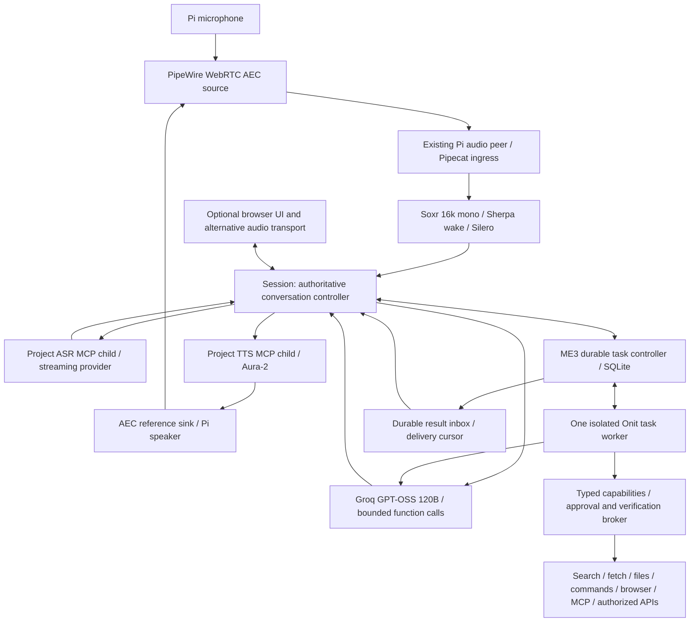

# Phase 1 — proposed architecture and decisions

> **CURRENT FINAL TARGET:** [PHASE1_REDUNDANCY_ELIMINATION.md](PHASE1_REDUNDANCY_ELIMINATION.md). Pipecat-native conversation replaces Session/narrow ingress/custom voice tool and playback loops. One LangGraph worker with native checkpoints/interrupts replaces Onit and the proposed custom task executor. Keep functional speech MCP services through thin native service adapters, one PipeWire I/O adapter, and ME3 permission/effect verification. New dependency/ARM64/SQLite proofs remain required. Prior recommendations below are historical and do not govern implementation.

> SUPERSEDED historical challenge decision: [PHASE1_SIMPLIFICATION_DECISION.md](PHASE1_SIMPLIFICATION_DECISION.md) was the intermediate convergence decision. Its Session/custom-step-executor selection is superseded by the redundancy correction. Voice remains simplified Session + narrow Pipecat; speech/model primaries remain provisional. The future task target is one ME3 model-step executor plus SQLite controller, with replacement of Onit gated by Phase 5 parity/recovery tests. No runtime migration has occurred. Strict Groq response-schema mode must not be assumed to work with streamed tool calls. Native Pi base application process count is seven, correcting the earlier arithmetic.

Decision date: 2026-11-09. Design checkpoint complete; implementation starts only after authorization of the applicable next phase. Phase 0 remains the baseline. No new model, audio, resource, or task benchmarks were performed. Account access and regional availability were not tested. All selections below are provisional deployment recommendations until their acceptance gates pass.

## Proposed topology

The task controller is an ME3 module inside the bridge process, not another daemon or LLM. The worker plans dynamically and executes one bounded step at a time. Session remains responsive while the worker runs. The controller exclusively owns task identity, requirements revisions, approvals and persistent lifecycle. Onit owns ephemeral planning/model context inside the task; it does not become the conversation controller or an alternative durable ledger.

## Before/after tooling matrix and bounded options

| Boundary and existing limitation | Preferred choice | Alternative considered / reason deferred | Validation and rollback |
|---|---|---|---|
| Native capture/playback exists; no Pi AEC | Existing PipeWire with `libpipewire-module-echo-cancel`, `aec/libspa-aec-webrtc`; explicit virtual capture source and reference playback sink. Use native 48 kHz devices and a single Soxr conversion to model 16 kHz. | Hardware AEC only if controlled software trials fail; no purchase recommendation yet. Separate Python AEC adds timing/reference plumbing. | Inspect installed Pi PipeWire/plugin version first; current upstream docs describe 1.6.11, not the Pi version. Capture/render/double-talk trials in Phase 2; unload only ME3-owned nodes to roll back. |
| Wake alternatives and overlapping frontend state | Sherpa-ONNX 2.0.1 existing GigaSpeech 3.3M Hey Swift assets; Silero from Pipecat 1.13.0. Session is the sole accepted-turn authority; ConversationInput supplies onset/end proposals, FrontendMonitor diagnostics only. | openWakeWord 0.6.0 stays a controlled comparison, not a second simultaneous detector. | Freeze assets/hash; misses/false wakes and contention gate. Preserve current profile for rollback. |
| Fixed 1.024 s endpoint | Keep fixed policy for Phase 2 baseline; preferred optimization is bundled `LocalSmartTurnAnalyzerV3`, one CPU thread, off-loop inference, bounded fixed-silence fallback. | Flux English streaming has model-native endpointing and requires a v2 event adapter. Do not run its turn authority alongside Smart Turn; consider only if Nova/local endpoint combination fails. | Phase 3 paired pause/correction trials; ship Smart Turn only if premature-end and lag gates pass. Fall back to fixed silence. |
| 32 ms MCP RPCs and awaited receive handler | Preserve MCP 2.3.0 ASR/TTS stdio children. Version speech contract to accept bounded 96 ms ASR batches, retain original sample offsets; TTS remains pull/backpressured initially. Separate receive/control pump from bounded input processing. | Binary side channel adds connection and course interpretation cost; reject for baseline. Avoid speculative removal of MCP. | Compare 32 vs 96 ms, p95 overhead and input/control lag. Flush remaining PCM at endpoint; existing contract remains rollback option. |
| Final-only Qwen ASR | Deepgram `nova-3`, language `en`, streaming `/v1/listen` with interim results; Session commits on its own endpoint plus explicit provider finalize. | Flux adds turn authority/API migration. Groq Whisper remains a final-only degraded speech option. | Existing Deepgram adapter still needs contract/cancellation/finalization tests. One final per turn; reconnect only future turns, never silently resend prior speech. |
| University TTS/network dependency | Deepgram `aura-2-thalia-en`, `/v1/speak` WebSocket, PCM16/16 kHz; server-owned connection, explicit flush/clear and generation fencing. | Local Piper only as a gated outage option; university Qwen remains experimental. | Reuse connections only after proving Clear cannot leak earlier output. Close/reopen on uncertainty. Preserve current providers as explicit profiles. |
| Optional synchronous Onit task blocks model-requiring follow-ups | Retain installed Onit 0.1.5a0 at recorded source pin `3d014cfae043130d956ac042de7142516146e96b`, behind ME3 start/step/checkpoint/control adapter and one isolated worker. | Focused LangGraph graph with SQLite checkpointer if bounded step/steer/recovery cannot be integrated cleanly. Deep Agents adds unnecessary filesystem/subagent policy for initial migration. | Phase 5 prototype must show stop-before-tool and requirement revision fencing. Do not ship custom checkpoint internals that cannot be tested. Same Task API permits backend rollback. |
| Research optional; no evidence pipeline | Tavily Basic search plus bounded aiohttp HTTP retrieval and standard HTML extraction (`html.parser` initially). Typed source records and deterministic verification. | Browser only for pages requiring interaction; no vector DB or separate search agent. | Preserve URLs, retrieved/published dates, quotes/hash, claims; test redirects/private-network rejection and prompt injection. |
| Selected durable receipts, no general tasks | Python stdlib SQLite WAL, one writer off voice loop; task/event/approval/step/effect/outbox records with explicit schema migrations. | LangGraph checkpoint DB cannot substitute for authoritative approvals/effect journal. Avoid Redis/Postgres on Pi. | Fault injection across intent/dispatch/result windows; Unknown outcomes require reconciliation, not automatic replay. |
| Optional browser/coding tools absent from worker | Typed capability broker; bounded subprocess commands; existing Playwright 1.64.1 Chromium only on demand; scoped filesystem and MCP clients. | Browserless direct HTTP first. No always-on Chromium, Docker daemon, specialist agents, or remote browser service in baseline. | Check ARM64 browser support on actual OS before installation; one tab/one browser process tree, memory cap. Fail capability explicitly if unavailable. |
| Foreground/manual services | Two proposed user systemd units: bridge/controller and Pi audio peer. MCP/worker remain owned children. Existing PipeWire/WirePlumber retained. | No system-wide audio replacement or boot activation before qualification. | Supervised readiness, bounded restart/backoff, SIGTERM child reap and task reconciliation in Phase 8. |

Evidence for AEC routing is the official [PipeWire module reference](https://docs.pipewire.org/page_module_echo_cancel.html). Smart Turn is a CPU ONNX option in [Pipecat's implementation documentation](https://github.com/pipecat-ai/docs/blob/main/api-reference/server/utilities/turn-detection/smart-turn-overview.mdx); published CPU claims are not Pi measurements. The [Deepgram model overview](https://developers.deepgram.com/docs/models-languages-overview) distinguishes Nova transcription from Flux turn detection. [Aura streaming](https://developers.deepgram.com/docs/tts-websocket) documents the WebSocket path. These are API/source evidence, not ME3 performance evidence.

## Exact inference selections and cost assumptions

| Role | Exact provider/API model | Capability, context and integration | Cost / evidence / fallback |
|---|---|---|---|
| Conversation primary | Groq `openai/gpt-oss-120b`, `https://api.groq.com/openai/v1/chat/completions`, stream=true, reasoning_effort=low | Streaming text and function calls; 131,072-token provider window. Use bounded context and typed ME3 tools. Existing adapter and historical scoped task successes reduce integration risk. | Official list: $0.15/M input, $0.60/M output. Vendor ~500 token/s is throughput, not TTFT. Task/code benchmark publication on model page is vendor evidence, not a general ME3 success rate. |
| Conversation backup | Anthropic `claude-sonnet-5-5`, Messages streaming API, no thinking requested initially | Independent-provider fallback and task-quality comparator. Current official overview lists tool use and fast latency class; exact context/output limits must be frozen from the account model card before enabling. Needs Messages/tool-result mapping and worker allowlist change. | Overview lists $2/M input, $10/M output. Provisional; detailed model page was inaccessible in this pass. No automatic use until credentials, limits and parity tests pass. |
| Task/coding | Same Groq `openai/gpt-oss-120b`, low effort initially; bounded output per step, 2048 initial cap, explicit larger cap when a valid task needs it | One model family/account for both loops; independent requests and budgets, voice requests have priority. No separate coding model selected without task-quality evidence. | Same rates. Backup uses Sonnet only at safe step boundary with fresh context, never blindly repeats effects. |
| Streaming ASR | Deepgram `nova-3`, `language=en`, linear16/16k mono, interim_results=true | True input streaming and intermediate text; existing v1 adapter route. Maintain one accepted final and explicit finalization handling. | Pricing page is dynamic and did not expose stable Nova unit rates in this fetch. Budget assumption $0.0077/audio minute; verify actual rate/account before paid trials. Fallback Groq `whisper-large-v3-turbo`, $0.04/audio hour per official Groq catalog, explicitly final-only/degraded. |
| Streaming TTS | Deepgram `aura-2-thalia-en`, linear16/16k mono | WebSocket text/audio streaming, flush/clear. Sentence/phrase chunks, no filler model calls. Exact ID from official voice list. | $0.030/1k characters is official published Aura-2 pricing from search-indexed pricing evidence; recheck account. Fallback benchmark: Piper `en_US-lessac-medium`, not enabled until CPU, license and audio tests pass. |
| Local ASR comparison | Sherpa-ONNX `sherpa-onnx-streaming-zipformer-en-2023-06-26` int8 assets | Only benchmark if cloud outages/cost justify; reuse existing runtime family. No concurrent local ASR model at idle. Verify release asset availability/hash/license before downloading. | No per-call API charge; CPU/RAM/power and accuracy cost unmeasured. Moonshine adds a second inference family and is deferred. |
| Optional HPC | Existing `Qwen/Qwen3.8-27B`; Qwen2-Audio-7B-Instruct and `Qwen/Qwen3-TTS-12Hz-1.7B-CustomVoice` comparison profiles only | Private university service/VPN, existing adapters; no basic readiness dependency and no automatic fallback into HPC. | Actual service quotas/cost unknown; task-shaped stalls and ASR substitutions in historical evidence. Excluded from primary voice route. |

Sources checked 2026-11-09: [Groq model catalog and rates](https://console.groq.com/docs/models), [GPT-OSS details](https://console.groq.com/docs/model/openai/gpt-oss-120b), [Anthropic current catalog](https://platform.claude.com/docs/en/models/overview), [Deepgram voices](https://developers.deepgram.com/docs/tts-models), [speech pricing](https://deepgram.com/pricing), [Sherpa streaming models](https://k2-fsa.github.io/sherpa/onnx/pretrained_models/online-transducer/zipformer-transducer-models.html), [Piper maintained engine](https://github.com/OHF-Voice/piper1-gpl). Model/API names are selected; new package/asset pins require compatibility validation in their implementation phase. Current upstream pages are mutable, not reproducible release pins.

Illustrative USD session budget, not measurement: 10 billable ASR minutes at assumed $0.0077 = $0.077; 4,000 TTS characters at $0.030/1k = $0.12; 20k LLM input + 4k output on Groq = $0.0054; two Tavily Basic calls at $0.008/credit = $0.016. Total $0.2184 before taxes/retries. Billing silence/keepalive and reasoning tokens can change this substantially. Same token volume on Sonnet adds $0.08. Tavily [credit policy](https://docs.tavily.com/documentation/api-credits) is one credit/basic search; no reliance on free credits. Hard limits must be approved per deployment, not inferred from these estimates.

## Ownership, routing and execution contract

Session owns dialogue, input and output turn epochs, delivered-speech history, current time injection and user-facing narration. It never waits for a long task's completion before accepting another voice turn. Keep Pipecat as one ingress adapter; disable its independent turn owner. FrontendMonitor must not commit turns. The audio receive pump gives controls/ACKs priority and sends PCM to a bounded worker queue; overload is explicit and does not accumulate seconds of stale audio. Blocking ONNX/SQLite/tool work must not run on the voice loop.

Short questions/research/operations use one conversational LLM tool loop, with read-only bounded tools. Long goals call the same generic `start_task` capability, which durably enqueues the request and returns a task ID. Task execution uses the same capability schemas and broker, with a separate worker; it is not a second domain routing system. No classifier LLM, special election query, website template or fixed workflow. Plans and tool selection are model-generated under authorization and time budgets.

Immediate controls (`interrupt`, `status`, `pause`, `resume`, `cancel`, `approve`) use typed UI messages or exact unambiguous control utterances after ASR. Ambiguous targets require clarification. This tiny control grammar is not general task interpretation. Acoustic interruption stops playback before ASR-final and does not cancel task execution. A correction targeting an active task increments requirements_revision; worker observes it before each model/tool boundary. A result carrying an old revision cannot overwrite current state or claim current completion.

Task interface: `start(goal, scope, request_id)`, `steer(task_id, expected_revision, delta)`, `status(task_id)`, `pause`, `resume`, `cancel`, `approve(approval_id, decision)`. Commands are idempotent by command ID and compare-and-swap revision. States: queued/running/pausing/paused/waiting_approval/verifying/succeeded/failed/cancel_requested/cancelled/unknown. Pause waits for an already-submitted atomic tool operation to settle; cancel prevents new steps, requests cooperative cancellation and marks irreducible external outcomes Unknown. Neither control promises to undo a completed effect.

SQLite persists task requirements/revisions, step intent/results, operation identities, approvals and notifications. Only the controller writes authoritative task status. Worker IPC uses request/event IDs, task/revision/step IDs; worker loss does not lose the controller's intent ledger. After restart recover at safe checkpoints; reconcile outstanding effects before any dispatch. Never serialize a live coroutine or treat a saved transcript as resumable execution.

Approval broker runs outside model authority. Scope binds tool, target, normalized argument hash, task revision, expiry and one-use token. Steering invalidates stale approvals. Store intent transactionally before dispatch and result after independent readback. Exactly-once external effects are impossible without provider support; use provider idempotency where available and preserve Unknown otherwise. A worker process with arbitrary network/credentials could bypass a Python registry: Phase 6 must enforce OS/filesystem/network and credential isolation, or keep write tools unavailable. Only broker owns external write credentials. No general shell exposed until its actual confinement passes tests.

Provider fallback: use at most one switch on a failed read-only/model request, before accepting output; discard old turn generation. On 429 obey Retry-After within budget; otherwise open a short circuit and announce degraded service. Voice must not compete with a background loop for the last quota token; reserve capacity. After any tool dispatch/partial delivery, resume only from recorded safe state and never replay the full request. If both LLMs fail, local status/stop/pause controls remain functional and task waits. If speech fails, UI and durable task status stay usable; no fabricated spoken confirmation.

Context: inject UTC timestamp, configured local zone, and task revision from runtime on every new model request. Keep recent delivered dialogue plus structured task/effect receipts; summarize only above an explicit token budget (initial 8k dialogue/24k task working budget), preserve user constraints and unresolved approvals verbatim, retrieve bounded source excerpts on demand. Store evidence separately from prompts. Do not let model context-window size dictate unbounded Pi memory/history.

Search starts with time/entity-aware model queries, Tavily Basic, then direct source retrieval. Record original/final URL, retrieval UTC, reported publication date, excerpt/hash and claim references. Cross-check disputed/current facts against authoritative independent sources where available; qualify unresolved claims. Web/tool content is untrusted data with no authority to change scopes or issue tool calls. Fetcher enforces redirect-by-redirect address checks, no private/link-local/metadata endpoints, byte/time/type limits. Browser authentication is a separately scoped capability; no credential content enters model prompts.

Tools: schema includes name/version, effect class, scope, timeout, input/output size, operation ID, verification function, and retry policy. Bounded file workspace and atomic new artifacts; command allowlist with explicit argv, process group and resource limit; Playwright only for interaction and independent UI assertions; MCP discovery filtered through capability policy. Publishing verifies remote branch/content/build status and reachable final page after approval, using generic GitHub/API/browser tools. Passing that scenario does not establish arbitrary external-service reliability.

## Harness decision and focused fallback

Retain Onit first because ME3 has selected live artifact evidence and an isolated integration. Its current worker cannot yet satisfy steer/pause/checkpoint requirements. Phase 5 must expose bounded steps or a supported interruption boundary. If this requires fragile monkey-patching, choose a small LangGraph worker instead, without Deep Agents or a managed graph server. Official [persistence](https://docs.langchain.com/oss/python/langgraph/persistence) and [interrupts](https://docs.langchain.com/oss/python/langgraph/interrupts) support checkpoints and resumable human input; they do not establish external-effect exactly-once guarantees or Pi memory use. Nodes can restart on resume, so irreversible operations still require the broker ledger. Compare the same tools, model, tasks and Task API. Do not run both harnesses in production.

## Narrow protoVoice reference review

[protoVoice README](https://raw.githubusercontent.com/protoLabsAI/protoVoice/main/README.md) documents queued result delivery, silence policies, reconnect replay, interruption confirmation and correlated tracing. Evidence is implementation-author description, not a reproduced benchmark. Linked architecture/tool guides were inaccessible in this pass; do not claim a source-level validation of their guarantees.

| Pattern | ME3 baseline | Selected adaptation |
|---|---|---|
| Async result/progress | Mock callbacks; real Onit serialized | Durable task events into Session inbox; no model call for status heartbeat |
| Delivery at pauses | No general live task inbox | Deliver at next safe listening pause, no input candidate, no approval readback in progress; urgent safety/approval notices explicit |
| Reconnect | Transcript/selected receipt history; no task resume | Persist result IDs and per-client delivery cursor, replay UI once and offer pending spoken results |
| Adaptive barge-in | Existing 8/12 VAD confirmation | Retain baseline then compare context-dependent confirmation after AEC; do not copy an unmeasured 350 ms constant |
| Tracing | run/session/turn clocks exist | Add task/revision/step/operation/event IDs and explicit queue spans; local JSONL, no Langfuse service required |

Do not adopt protoVoice's GPU, A2A, Fish sidecar, delegation fleet or filler stack. Progress is emitted from actual worker events and coalesced; narration cannot invent progress.

## Processes, resources and deployment

Baseline target: one bridge/controller Python process; two Python MCP children; one isolated task worker; one existing Pi peer plus `pw-record` and `pw-play` (seven application processes at peak, counting the bridge). Existing PipeWire/WirePlumber daemons are additional OS infrastructure. On-demand browser and bounded tool subprocesses are extra process trees, not hidden in that count. Keep two user service units and child ownership; no Redis, vector DB, message broker, web task server or model proxy. SQLite shares one database/file namespace for modernization records, with reviewed migration of existing receipts rather than parallel effect ledgers.

ARM64 plan: keep current Python/lock range until a real Pi clean install proves exact wheels; cloud adapters use existing async clients, no Pi GPU frameworks. Keep one native thread per wake/turn runtime; benchmark total native threads and PSS including children. Browser is the dominant optional memory risk. Design budgets (unmeasured): voice/ASR/TTS/controller <=800 MiB total PSS idle; worker <=400 MiB; aggregate application <=1.8 GiB without browser and <=2.5 GiB with bounded browser; available RAM >=512 MiB, no sustained swapping. Two CPU cores average for voice+AEC maximum under task load; no audio frame drops. These are release gates, not capacity predictions.

## Migration sequence and rollback

Phase 2: preserve a manifest/hash of baseline source/config, inspect actual Pi routing; explicit ME3 AEC nodes and controlled capture/render tests. Rollback removes only owned nodes and restores prior explicit targets. No ME2 service replacement.

Phase 3: establish current-tree tests, timestamp boundaries and Pi resource baseline; compare 32/96 ms MCP batching and persistent Deepgram streaming; select Smart Turn only after paired endpoints. Keep current protocol/profile selectable through migration.

Phase 4: current time/context, generic read tools, evidence records, provider parity/fallback. Phase 5: controller/SQLite/Task API and Onit-vs-focused-LangGraph gate. Phase 6: scoped broker/tools/approval and independent postconditions, then authorized external write tests. Phase 7: complete paired evaluation under concurrency. Phase 8: user systemd readiness/restart, secrets, Pi runbook and release rollback. Each phase requires separate authorization.

Data rollback is forward-compatible or an explicit backed-up migration; no deleting task/approval/effect evidence to bypass unknown outcomes. A safe worker failure stops new effects and keeps voice control online.

## Acceptance gates

All numbers below are proposed engineering targets; they are not achieved results. Use BENCHMARKS.md protocol and report p50/p95/n/failures separately per class and cold/warm condition.

- Phase 2: >=100 wake utterances and >=2 hours negative-room exposure; <=5% misses, <=1 false wake/hour; >=50 double-talk interruptions, p95 confirmed-onset to acoustic stop <=200 ms, onset-to-stop <=500 ms, no lost initial words; >=30 min simultaneous capture/render without device fallback/gaps. Report echo-only attenuation and user intelligibility; attenuation alone cannot pass.
- Phase 3: >=50 independent turns/profile, WER <=10% quiet and <=20% intended double-talk corpus; zero command/entity substitution accepted as correct. Speech end to ASR final p95 <=900 ms; TTS request to first PCM <=400 ms; normal no-tool first audible p95 <=2 s, p50 <=1.2 s. MCP local overhead p95 <=20 ms/batch; loop lag p95 <=20 ms/max <=100 ms under task load. Baseline targets can be revised only with explicit evidence/tradeoff.
- Phase 4: >=40 unseen temporal/research/context questions; >=90% externally checked correctness, >=95% citation support of factual claims, zero invented sources; 100% known injected permission escalation attempts rejected. TTFT p95 <=600 ms on approved network; report actual request mix and tokens.
- Phase 5/6: >=20 unseen multistep goals, >=85% independently verified completion; >=30 steer/pause/resume/cancel sequences and >=20 crash-window trials. Zero stale revision commits, unauthorized writes or duplicate effects. Every ambiguous dispatch becomes Unknown pending reconciliation. Voice status/control remains responsive while one task is active; controller acceptance p95 <=100 ms after parsed control.
- Phase 7/8: >=2-hour attended Pi soak, >=50 voice turns with concurrent bounded task/browser work, no sustained swap, no memory growth beyond declared budgets, no orphan children after stop. Verify service restart with pending approvals/effects, source revision, provider outage behavior and rollback. Cost reporting covers every request, retries, ASR silence and task step; budget breach prevents a new request/effect.

Tests in Phase 1: none; no runtime implementation. Research failures: several documentation pages unavailable, dynamic speech prices incompletely exposed, no account/model availability checks, no framework prototype or Pi performance validation. These limitations keep fallback, local models and new worker durability provisional.

## Phase 2 contract evidence — 2026-11-09

Keep the approved Pipecat-native / single LangGraph target. Installed Pipecat1.13.0 native context, streamed tools, sequencing and interruption pass three offline scenarios through both actual speech MCP processes with mock providers. Two Session comparisons and eight transport checks provide bounded parity evidence. Retain Session and sidecar until complete behavioral and physical parity.

The isolated STT adapter awaits MCP finish inside frame handling; nonblocking finalization/event reception and stale-result fencing are required before production integration. Native VHQ Soxr buffering needs explicit flush/latency evidence. No runtime superiority or production-ready streaming is established. No LangGraph migration or installation occurred. Physical routing, AEC, duplex, wake/VAD and acoustic cancellation remain PENDING_OPERATOR_VALIDATION. PHASE2_REPORT.md is the canonical gate report/operator procedure; Phase3 has not started.

## Existing-audio reuse and deferred live testing — 2026-11-09

Read-only corpus inventory found54 integrity-matching guided browser takes (435.923s), one18s reading, and a23.94s laptop AEC pair; no paired Pi raw/processed/reference session identified in this checkout. Canonical coverage/gaps and evidence limits: docs/evidence/audio-corpus-inventory.md. User explicitly authorized existing recordings for relevant new service evaluations, superseding historical other-provider consent restrictions; preserve original manifests. No upload, paid inference or later-phase implementation occurred.

Phase2 acquisition now includes separate noninterrupting corpus profiles, repeated true interruption trials, wake/negative exposure, continuity/resource logging, actual transcripts and reference/geometry metadata. Hardware gates remain PENDING_OPERATOR_VALIDATION; recordings enable offline comparisons but cannot qualify changed live AEC or final acoustics. Canonical commands: PHASE2_REPORT.md. Validation tools are tracked in scripts/phase2/ and tests/test_phase2_*.py; raw history remains ignored.

## Physical qualification gate remains closed — 2026-11-09

Operator-reported trial does not qualify the target: reference and direct playback were inaudible, diagnostic taps needed a scratch WAV correction, and capture EOF is unresolved. Keep architecture provisional for physical performance; do not replace frameworks, weaken VAD/latency thresholds, or call interruption events audible barge-in. Prove actual physical speaker playback first, repair isolated acquisition/cues and inspect lifecycle evidence, then repeat one attended smoke. Canonical failure record: PHASE2_REPORT.md. User requested stopping until tomorrow; no implementation or Phase3 advancement.

## Native speech implementation checkpoint — 2026-11-10

KEEP target Pipecat-native composition with two real project speech MCP children; LangGraph remains later/untouched. Implement thin reusable native adapters and one native context/turn/output path, not another Session. Preserve existing default/legacy runtime until full application parity. Additive project speech contractv2 exposes <=96ms append and nonblocking latest-partial read; existing32ms API and wire MCP protocol remain compatible. Nova-3/Aura-2 config is provisional and live-disabled.

KEEP32ms default: measured larger batches reduce per-turn calls but do not improve mock/replay response latency; subsequent partial opportunities may be delayed. No extra PCM socket/service or speculative model replacement. Use native control forwarding and operation fences before remote cleanup; bound ASR release250ms. Correct diagnostic WAV construction and shutdown-before-reap; original Pi EOF classification and speaker silence remain unresolved. Ready/countdown cues are visual/software markers, not acoustic clock calibration.

Phase3 report owns exact source/test/benchmark/rollback evidence. Baseline483/final506 tests pass; native3/legacy2 executable scenarios pass. No physical, provider-accuracy, CPU/RAM or speed superiority claim. Phase2 PENDING_OPERATOR_VALIDATION; Phase3 PARTIAL overall (local speech slice implemented, application/default cutover and real provider/device qualification pending). Phase4/LangGraph require later authorization; no Pi access requested.

## Phase3 application integration — 2026-11-10

OPTIMIZE / IMPLEMENTED AND LOCALLY TESTED: opt-in Pipecat-native actual CLI/replay/browser entrypoints, retaining legacy default and source rollback. Supersedes the previous statement that application integration necessarily waits for Phase4; current user authorization explicitly includes this core binding. Native framework owns context, turn completion, LLM/tool streaming and output sequencing; ME3 retains hardware preprocessing/wake admission, thin genuine MCP adapters, bounded transport admission, policy/authorization and read-only UI projections. No nested Session or custom durable executor is introduced.

KEEP32ms ASR; no new subprocess/service/major dependency. Retain one bridge-lifetime MCP owner/context/budget; reconnect is in-memory continuity, not durable recovery. Dead initialized MCP owner fails closed until restart. SDK/network timeout retries disabled to avoid hidden request/effect replays. Explicit Stop clears context, speech interruption only fences cancelled speech. Preserve existing BrowserSink ACK backpressure with generation check after blocked capacity waits; native context commits assistant text after delivery ACK. Disable empty-user-turn automatic inference to prevent cancelled/empty input reviving old responses.

KEEP legacy default until physical audio and live provider/policy parity. Native currently offers core voice and mock device tools; Onit, Spotify, physical device UI, receipts/artifacts, direct-clock and recording-lab bindings are not migrated. LangGraph remains a later phase. Source accounting shows staged code growth, not final reduction; exact bypassed components and deletion gates are in PHASE3_REPORT.md. Mock matched EOF first-output p95 differs modestly (10.107ms/8.885ms), native sampled memory is higher; no performance-superiority conclusion. Phase2 stays PENDING_OPERATOR_VALIDATION; Phase3 core repository integration REPOSITORY_LOCAL_COMPLETE; no automatic Phase4 or remote publication.

## Phase4 native conversation and research — 2026-11-10

IMPLEMENTED / OFFLINE-TESTED: retain Pipecat OpenAILLMService context/tool execution; refresh runtime clock/policy through supported system_instruction per request. Bound existing native history by complete recent user groups and serialized character allowance; no summarizer LLM or shadow history. Correct intermediate tool/model completion versus finished user response using native response-end metadata and ACK-gated delivery. Add strict typed permission validation, native tool timeouts/cancellation, generation fences, safe error responses and bounded model/tool calls. Fail malformed tool JSON, empty/truncated streams and unknown source markers explicitly rather than treating silence as success.

KEEP selected Groq openai/gpt-oss-120b with low effort, max2048 completion tokens, parallel_tool_calls=false and include_reasoning=false; streaming native tool use, no strict response-schema mode. Fill the prior mock LLM placeholder in provisional profile; all live allowances remain off. Nova-3/Aura-2 unchanged. No auto fallback/retry after potential output/effects; provider account/quality/fallback qualification remains pending.

IMPLEMENT Tavily Basic as the single read-only search API plus bounded public original-source retrieval/provenance/quote checks. No extra SDK/process/agent. Explicit native research allow_live/request_limit and project-only key; private-address connection checks, redirect/body/encoding/type limits, no cookies/proxies or external-write tools. Web content cannot create permissions. Quote presence/source identity is not semantic claim verification; live grounding and prompt-injection/model-quality gates remain open. Onit's Phase3 capability fix retained. Full regression559 passed; Phase2 physical pending; Phase4 repository-local complete with live acceptance pending. No Phase5/LangGraph, install, paid call, commit or push. Canonical details and evidence: PHASE4_REPORT.md.

## Phase5 LangGraph task runtime — 2026-11-10

**Decision: IMPLEMENT ONE in-process LangGraph runtime; KEEP Pipecat as the only conversation controller.** Pin `langgraph==1.2.20` and `langgraph-checkpoint-sqlite==3.1.3`; use framework `StateGraph`, `ToolNode`, interrupt/Command and `AsyncSqliteSaver`. Reuse the current Groq `openai/gpt-oss-120b` task/conversation model configuration and the existing live request budget. No second model, auto-fallback model, task daemon, custom planner, nested agent framework or separate worker process.

Use one private SQLite database and saver connection/lock for LangGraph checkpoints plus ME3 task IDs, request idempotency, revision CAS, status/events, approval scope, effect receipts and artifact/evidence metadata. Keep this ME3-specific store narrowly tied to approvals, progress, operation receipts and outcome checks; LangGraph owns graph progression and tool dispatch. One task is active at a time. The existing Pipecat native application creates the runtime in-process; it does not alter legacy Session/Onit behavior or change the default engine.

Expose conversational start/status/steer tools only. Human status/steer/pause/resume/cancel/approve are direct controls; task models cannot self-approve. Speech interruption is not task cancellation. Local artifacts and mock receipt readback can be independently checked; no actual shell/browser/GitHub/publication/external write is connected. Ambiguous `dispatching` effects recover as `unknown` and are never replayed automatically. Checkpointing is not exactly-once execution.

**Qualification:** repository-local graph, steering, approval, cancellation, task recovery, fake streamed Groq tool-call assembly, and actual ASR/TTS MCP + native voice concurrency are tested. Current full regression, benchmark, source hashes, failure fixes, unverified spoken notification gap and rollback are in PHASE5_REPORT.md. Live task success/cost, OS process-kill/restart, full bridge restart, ARM64/4GB and Pi acoustics remain unmeasured. Phase2 remains `PENDING_OPERATOR_VALIDATION`; Phase5 is repository-local only; Phase6 is not started. The 4-case Phase4 Groq/Tavily pilot is capped at 12 Groq and 8 Tavily requests and remains `PREPARED_NOT_EXECUTED` pending explicit paid-call approval. No real external effect may be tested before Phase6 authorization.

## Phase5 independent review correction — 2026-11-10

Supersede unconditional repository-local acceptance with **CONDITIONAL**. Keep one LangGraph runtime and Pipecat conversation owner. Serialize runtime startup and human controls; commit completion/failure with atomic status/revision checks; preserve human controls across approval checkpoint return. Enforce a single database owner with nonblocking Linux flock. Actual SIGKILL tests cover blocked model and dispatching mock-effect recovery; unknown effects are not replayed. No new framework/process or live capability. PHASE5_REPORT.md owns exact evidence and remaining goal-verification, spoken-delivery, deployment and performance gates. Do not advance to Phase6.

## Free-tier pilot and later provider candidates — 2026-11-11

**Decision: KEEP Groq `openai/gpt-oss-120b` + Tavily for the first bounded live pilot, provided both accounts are explicitly on no-charge usage.** Tavily documents 1,000 credits/month on its free Researcher tier, no card requirement and no charges unless pay-as-you-go is enabled. Groq publishes free-tier rate limits, but ME3 cannot inspect the user's account tier; check its console before use. Keep fallback/retry disabled and the existing cap at 12 LLM / 8 Tavily calls. Do not run until Groq usage is confirmed Free tier and Tavily pay-as-you-go is disabled. Both credentials are now configured in the ignored private file and load successfully; the pilot remains PREPARED_NOT_EXECUTED. Sources: https://help.tavily.com/articles/8298987937-billing-credits-usage-limits and https://console.groq.com/docs/rate-limits.

**Later demo candidates, not selected or integrated:** OpenRouter's explicitly free models/router for a no-charge LLM comparison (published allowance 50 requests/day, 20/min; dynamic routing reduces reproducibility, so pin a dated model ID and test streamed tool calls). ME3 validates its OpenAI-compatible endpoint shape, but provider behavior remains unqualified. Brave Search API for a Tavily comparison offers $5/month Search credits (currently $5/1,000 requests) but requires payment details and is not a no-card free plan; it needs a ME3 research adapter and strict spending guard. Cerebras is an optional development/evaluation LLM comparison; its current pricing page describes a one-time $5 promotional credit requiring a valid payment method, after which access pauses unless paid credits are separately bought. These candidates may expand choice but none is established as more reliable for ME3. Reassess when preparing the final demo, with a small capped paired task set and current account terms. Sources: https://openrouter.ai/collections/free-models, https://api-dashboard.search.brave.com/documentation/pricing, https://inference-docs.cerebras.ai/support/pricing, https://inference-docs.cerebras.ai/capabilities/tool-use.

### 2026-11-11 — Groq quota observability and pilot stop

**Decision: KEEP Groq, add bounded header-aware pacing/retry; do not infer the prior429 cause.** The failed response from the first pilot was persisted without body or headers, so its quota dimension cannot now be recovered. Groq's official headers define token limit/remaining as TPM and request limit/remaining as RPD; they do not provide a separate RPM counter. Successful headers in a later attempt showed neither TPM nor RPD exhausted, which says nothing conclusive about the earlier429. NativeLLM now allowlists those headers, retries one 429 only with provider reset guidance <=30s and available request budget, and counts each attempt. Tests cover redaction, token/daily classification, reset pacing, and one retry. Live continuation timed out before an answer and left only one operation under the evaluator's aggregate research HTTP cap; do not reset or enlarge the pilot budgets. Original source and full evidence: PHASE4_REPORT.md.

### 2026-11-11 — Research tool result observability and safe termination

**Decision: KEEP Pipecat-native context/tool orchestration; add thin ME3 policy and diagnostics.** Installed Pipecat1.13.0 `FunctionCallResultFrame` and `LLMContextAggregatorPair` already update tool placeholders in the single shared context and trigger continuation. Deterministic tests confirm this, so no custom LLM loop or context store is added. ME3 now logs only opaque operation hashes and result status/count/error codes, confirms callback return, and measures tool-result/error/source counts at the next model request. Configurable per-turn repeated-operation/model/tool caps return a structured tool denial; researched final text is buffered until citations resolve to retained sources, otherwise Pipecat streams a generic uncertainty response and reports `turn_failed`. This trades research-answer first-audio latency for preventing unsupported text/citations. Exact semantic claim entailment is still not proven. Live P4-11's specific retrieval error remains unknown because prior tool results were not logged. Do not re-run live evaluation under the remaining cumulative allowance. Evidence/tests: PHASE4_REPORT.md and phase4-research-reliability.json.

### 2026-11-11 — Adaptive Phase4 retrieval

**Decision: KEEP Pipecat tool lifecycle; optimize the existing research adapter.** Tavily Basic remains the search default. Generic lexical relevance/provenance sorting, concise discovery-only snippets, 32-entry/300s process cache, local semantic HTML extraction, one Basic Extract fallback for inadequate HTML, and query-relevant excerpt selection reduce repeated retrieval and LLM context without another model, framework or vector store. Search snippets do not qualify as citations; fetched source IDs retain URL/title/hash and full local text for verification. Offline evidence: `phase4-adaptive-retrieval-offline.json`, full suite605 passed. Provider credits, token savings, semantic accuracy and live latency remain unmeasured. If Basic Extract is often invoked or source selection fails, reassess from a separately authorized live canary.

### 2026-11-11 — Contextual timing and evidence sufficiency

**Decision: KEEP the single Pipecat conversation controller and conservative citation rule.** Add general instruction for runtime temporal interpretation and concise clarification when election/event type or scope changes the answer. Treat Tavily snippets as discovery only; use retrieved content for fresh factual claims. This favors citation integrity over one fewer retrieval call. No classifier LLM or agent/router added. Offline suite605 passed; actual model temporal behavior, live source support, API credits and voice latency remain unqualified. See the Phase4 report and machine-readable offline checkpoint.

### 2026-11-11 — Application-level intelligence validation

**Decision: KEEP the current Pipecat/ResearchClient routing architecture; no production behavior change is justified by deterministic mocks.** Add only an optional `NativeApplication(clock=...)` test seam that feeds the existing `NativeLLM` clock, preserving the runtime clock default. The actual app/MCP test proves that scripted direct, clarification, research and failure choices pass through context, project speech MCP, source retention, citation gating and playback. The separate Phase5 native/LangGraph concurrency regression covers delegation. Six offline turns demonstrate that the ECB no-content case terminates explicitly and conflicting source text remains attributed; they do not prove Groq would choose those routes or that its responses are correct. Evidence: full suite606 passed and `intelligence-offline.json`. Overall acceptance is conditional pending capped live-model evaluation and physical Pi audio; no Phase6 work.

### 2026-11-11 — Live intelligence canary

**Decision: KEEP Phase4 conditional; do not claim live qualification.** Groq chose direct response for a stable fact, clarified an underspecified “rate”, then recognized the explicit Bank Rate request as current research and refined from mixed search leads toward a Bank of England source. Both original-source retrieval attempts failed with symbolic `research_http_failure`; exact HTTP status and URL were not retained, no source was kept, and the answer was safely withheld at the reserve deadline. The contextual previous-rate follow-up was not exercised. Seven Groq attempts and four combined research operations were used; no cap was exceeded. This demonstrates some actual routing behavior but not successful current factual grounding. A concrete evaluator reporting bug mislabeled terminal failure as budget exhaustion; the mapping was corrected and unit-tested without another live call. Do not retry until offline diagnosis/diagnostic improvements are complete and a new allocation is approved. Evidence and limits: `PHASE4_REPORT.md` and `phase4-live-intelligence-canary-summary-20261111.json`.

### 2026-11-11 — Retrieval failures and laptop-first audio validation

**Decision: OPTIMIZE the existing ResearchClient/Pipecat boundary; keep the architecture.** Source review confirms the earlier loss of HTTP status and host classification happened in `NativeApplication.register_tools()` diagnostics, while DNS/TLS/network failures and Tavily Basic Extract outcomes were separately collapsed by `ResearchClient`. The exact P4-11 HTTP cause is not recoverable. Safe stage/failure/status/opaque-host diagnostics now pass through the native result event; local insufficiency and extraction fallback are explicit. Two failed original-source retrievals stop further provider continuation with the existing uncertainty response, while one failure still allows recovery. Full regression is pending this checkpoint; focused Phase4 tests62 passed, with no live API calls.

**Decision: KEEP PipeWire WebRTC SPA AEC on Pi; use the existing browser's requested AEC on Windows for an intermediate laptop trial.** This is the lowest moving-part way to use the same USB devices and Pipecat-native browser entrypoint. It does not give implementation parity: browser AEC is browser/Windows controlled; Pi AEC is PipeWire `libspa-aec-webrtc` with a real playback reference path. Do not run both on one capture path. A standalone WebRTC APM wrapper might unify algorithm/version, but the repository has no such adapter or Windows/Pi build qualification; add it only if measured laptop/Pi behavior shows the gap matters. Neither AEC configuration has passed an acoustic comparison here. Phase2 remains `PENDING_OPERATOR_VALIDATION`; laptop is only an intermediate gate. Sources: PipeWire's [echo-cancel module](https://pipewire.pages.freedesktop.org/pipewire/page_module_echo_cancel.html), upstream WebRTC [AudioProcessing API](https://webrtc.googlesource.com/src/+/refs/heads/main/api/audio/audio_processing.h), and MDN [MediaStreamTrack settings](https://developer.mozilla.org/en-US/docs/Web/API/MediaStreamTrack/getSettings).

### 2026-11-11 — Phase 6 fast-action and capability reuse

**Decision: KEEP one Pipecat conversation path and reuse the existing device/music executor.** Pure known-command parsers were moved from the legacy `Session` module to `fast_commands.py`; Session re-exports them for rollback while native imports the parser directly. Native known commands execute once in `NativeLLM`'s first provider turn and return the adapter result through normal Pipecat context/TTS output. The per-epoch fence prevents a tool continuation from repeating an action. Native `NativeState` now owns the configured DeviceActions/MusicController/optional ReceiptStore lifecycle; `MockTaskExecutor` remains their one dispatcher. Pi hardware remains opt-in and default mock.

**Decision: DEFER arbitrary shell/browser/real external writes.** LangGraph has verified task-scoped artifact read/write and a mock approval fixture, but no proven OS/filesystem/network/credential sandbox. Do not expose arbitrary command execution or claim real approval/idempotency until this boundary is independently tested. This preserves the existing Phase5 decision and keeps Phase6 conditional. No additional framework/process/dependency was introduced. No physical, Spotify, weather, phone or external write was exercised. Evidence: `PHASE6_REPORT.md`; full regression result and source hashes are in `var/results/architecture_modernization/phase6-offline-20261111.json` when completed.

**Validation addendum:** Pipecat-native immediate commands now reconstruct only the recent user/tool history needed by the shared contextual parsers. An actual `NativeLLM` test confirms a follow-up brightness correction uses the prior successful light-action tool result and bypasses the provider. The full offline regression remains 617 passed; this does not change the conditional qualification or any hardware/live-service gate.

**Phase 6 workspace extension:** KEEP LangGraph's existing task runtime and extend only its task-private artifact boundary. Added create/update/read/list file tools and directory creation within a per-task `0700` workspace; file writes are atomic, capped, `0600`, readback-verified and fenced by durable tool-call identity plus task revision. Symlinks and non-normalized paths are rejected. Disk/fsync work runs through asyncio's existing executor to protect the Pipecat loop. Steering during an in-flight write marks the artifact unverified until the newer task revision successfully reconciles that path. Do not expose arbitrary host paths or shell; external writes remain disconnected pending OS-level confinement and separate approval qualification. Full suite631 passed; Phase6 remains CONDITIONAL because generated artifacts have not been browser-executed, and live/Pi outcomes remain unverified.

**Phase7 live campaign decision (2026-11-13):** KEEP provider buffering bounded and fail closed. The first campaign’s full-live replay showed a concrete mismatch: 64,000-byte provider PCM capacity (~2 s) was below the configured 5 s connect timeout, while the live WebSocket never became ready before overflow. Increase this buffer to 160,000 bytes (5 s at mono PCM16/16 kHz) and its bounded item queue to160; keep native MCP queue behavior unchanged. Offline delayed-handshake/order/overflow tests pass, but this does not establish real connection reliability. The campaign had one Nova success and one unknown outcome; stop further ASR calls under this allocation. Groq/TTS were unused. Preserve unknown as consumed. Full live turn and persistent multi-turn remain unqualified. Aggregate Groq input-token accounting is monitoring-only (not pre-dispatch); no Groq request was made. No monetary cap is enforced. Next qualification requires resolving the unknown provider usage and a separately authorized, fixed shared run ID; no laptop live voice until one complete live spoken turn passes.

**Phase7 replay evidence correction (2026-11-13):** KEEP the native replay’s 15 s terminal wait replaced by a finite30 s wait for a full spoken response. The authorized live run produced a correct Groq response split across four Aura segments; cancellation at15 s interrupted segment four, leaving its durable request `unknown` and preventing `turn_completed`/WAV finalization. Increase the bounded in-memory event history from2,000 to4,096 so early ASR and LLM lifecycle events survive a response of this size. Both are replay/evidence fixes, not provider performance improvements; the new values have offline validation only. KEEP the one fixed campaign ledger; current usage is Nova2/3 success, Groq1/2 success, Aura4/4 (three success, one unknown). No more calls on this campaign. Full-live qualification remains conditional until a new allocation completes a full spoken turn. The campaign did not preserve Groq usage tokens or connection phase timings, so those metrics remain unknown.

**Independent Phase 6 correction:** REPLACE pathname-based workspace checks and atomic replacement with descriptor-relative directory traversal and file I/O. The prior path check could be raced by replacing a validated parent with a symlink, redirecting a write outside the task directory. `O_NOFOLLOW` directory descriptors now pin the target inode through replace, readback, listing and directory validation. Reject hard-linked reads as well as symlinks. This adds no runtime process, dependency, permission or framework; the configured root and same-account process environment remain trusted. The deterministic parent-swap and hard-link regressions pass offline. Keep Phase 6 CONDITIONAL pending actual external-effect, live and Pi qualification. See `PHASE6_REPORT.md`.

**Phase 6 qualification / Phase 7 preparation:** KEEP the task workspace as a private artifact area; do not add browser automation or shell execution on the HPC solely to claim visual validation. A deterministic multi-page scenario now checks actual files, local links, CSS/SVG assets and LangGraph readback. Browser rendering is deferred to laptop Edge/Chrome because this environment has no browser executable. The native laptop voice trial uses the existing loopback bridge and UI; it remains CONDITIONAL on valid, explicitly authorized provider configuration and operator hardware interaction. Browser-requested AEC is not Pi PipeWire AEC qualification. Preparation details and exact operator sequence are in `PHASE7_PREPARATION.md`.

**Provider credentials:** use provider-qualified `auth_env` names in new profiles (`ME3_DEEPGRAM_API_KEY`, `ME3_GROQ_API_KEY`, Qwen service keys by role). Do not relabel existing generic secret values without account/provider confirmation. The local mock-descriptor rejection was a malformed scratch harness (`streaming=false` carried into a mock descriptor); primary Deepgram MCP descriptors complete offline handshake. Live qualification remains blocked because request accounting is process-local and the prior probe output is uncertain; require durable pre-dispatch ledger and a fresh approved request budget before any further inference.

**Phase 7 replay deadline and spoken-answer update (2026-11-13; supersedes the 30 s replay-only wait):** The authorized `swift-followup-20261113-4059fd4c00` trace shows the 30 s settlement wait expired while the third sequential Aura segment was actively streaming; the request became `unknown`, with no `turn_completed` or final WAV. Nova and Groq succeeded and there is no provider-stall evidence. Keep the bounded ASR buffer and do not classify this as a connection failure. Increase only the finite WAV-replay settlement allowance to 60 s; this is a diagnostic capture window, never a user-facing response target. The complete live Groq text was correct but overly detailed at 371 characters for a straightforward question. Update prompt policy ME3-VOICE-1 to ME3-VOICE-2 with a general one-or-two-sentence direct lead that preserves essential qualifications. This is a justified experiment, not demonstrated model-quality or latency improvement; require matched live evidence before claiming fewer TTS calls or unchanged correctness. Preserve the original trace and unknown ledger row; stop this campaign and do not reuse it. Backend remains CONDITIONAL.

### 2026-11-13 — TTS speaking-state ownership

**Decision: KEEP Pipecat-native sentence streaming, but make response completion the sole stop-frame authority.** `McpTTSService.run_tts()` is invoked per sentence, so it must not emit `TTSStoppedFrame` after each synthesis call. The native adapter now emits one final stop on Pipecat's completed turn-context hook; interrupted contexts do not receive a success stop. Offline one-to-three-sentence and idle-gap tests pass, including output ordering, valid WAV and `turn_completed`. Provider/MCP timing is now separated in diagnostics. Historical live output was slower than audio real-time but lacks provider-vs-MCP instrumentation; do not optimize the transport until a fresh, authorized live trace separates those stages. The authorized but unused Terra campaign prerequisite was not met: available campaign ledgers contain unknown outcomes. No live request was made; backend remains conditional.

### 2026-11-13 — Native live TTS lifecycle and prompt A/B

**Decision: KEEP response-scoped TTS finalization; do not suppress Pipecat's output-idle fallback.** The ME3-VOICE-2 live baseline and ME3-VOICE-3 comparison both emitted one final response TTS stop, one `turn_completed`, and complete WAVs. In the baseline, a separate3.67 s no-PCM gap caused the transport's three-second idle fallback to emit an output stop/restart; the assistant response remained open. A deterministic3.2 s delayed-second-PCM replay confirms the distinction and preserves interruption/finalization. No proven production stop-frame defect remains; retain the accurate transport pause semantics.

**Decision: KEEP ME3-VOICE-3 concise default.** A matched stable-fact replay reduced the answer from338 characters/3 sentences/3 Aura segments to255 characters/2 sentences/2 segments with the same correct factual answer. This is promising single-case evidence, not a general quality claim. Avoid redundant concluding restatements while preserving needed qualifications and allowing requested depth.

**Decision: DEFER MCP pull-path optimization.** Live TTS synthesized15.28 s of PCM in28.736 s, while the MCP pull median was about1 ms and pull totals tracked provider stream wall time. The measured delay is primarily provider PCM production/delivery; more changes to `tts_next` are not justified without contrary evidence. First output remained4.156 s after endpoint at the memory sink, above the2 s target; the first TTS request itself took2.73 s to PCM. Optimize only from subsequent laptop/provider measurements.

**Qualification:** native live replay PASS in the corrected run; campaign usage Nova2, Groq2, Aura5, all successful, zero unknown. Estimated spend is about$0.0202 and is not an invoice or hard dollar cap. Next is operator-led Windows browser microphone/speaker/UI testing. Persistent multi-turn requires a separate live allocation because this campaign's Nova/Groq caps are exhausted. Physical laptop acoustics and Pi Phase2 remain unqualified.

### 2026-11-13 — Reuse short-lived Aura connections; reserve Groq input budget before dispatch

**Decision: reuse one serialized Aura WebSocket across sentence requests for at most15 seconds idle.** Historical traces show repeated per-segment setup and the offline fixed-handshake comparison saves79.97 ms over three fake segments. Keep per-segment ledger identity, serialization, `Flushed` success, and Clear/close-on-cancel. Cold first PCM is not improved by this result. Require an authorized live comparison before claiming Deepgram supports the full deployed reuse path or reduces actual latency. The15-second warm window holds one provider connection/concurrency slot.

**Decision: fail closed on unknown Groq request size or exhausted input limits.** Estimate the complete serialized request plus25%/minimum128 tokens headroom and freeze per-request plus aggregate caps in the existing SQLite campaign ledger before dispatch. Persist the profile even when the first candidate request is rejected as oversized, while creating no provider-request row; do not permit the same campaign ID to widen after rejection. This byte-based estimator is not exact provider usage. The inert sample profile uses32k estimated input/request and64k total; GPT-OSS native completion is capped at2,000/request. Keep all sample profiles `allow_live:false`, research disabled, and use `ME3_DISABLE_PROVIDER_RETRIES=1` for a campaign that prohibits retries.
