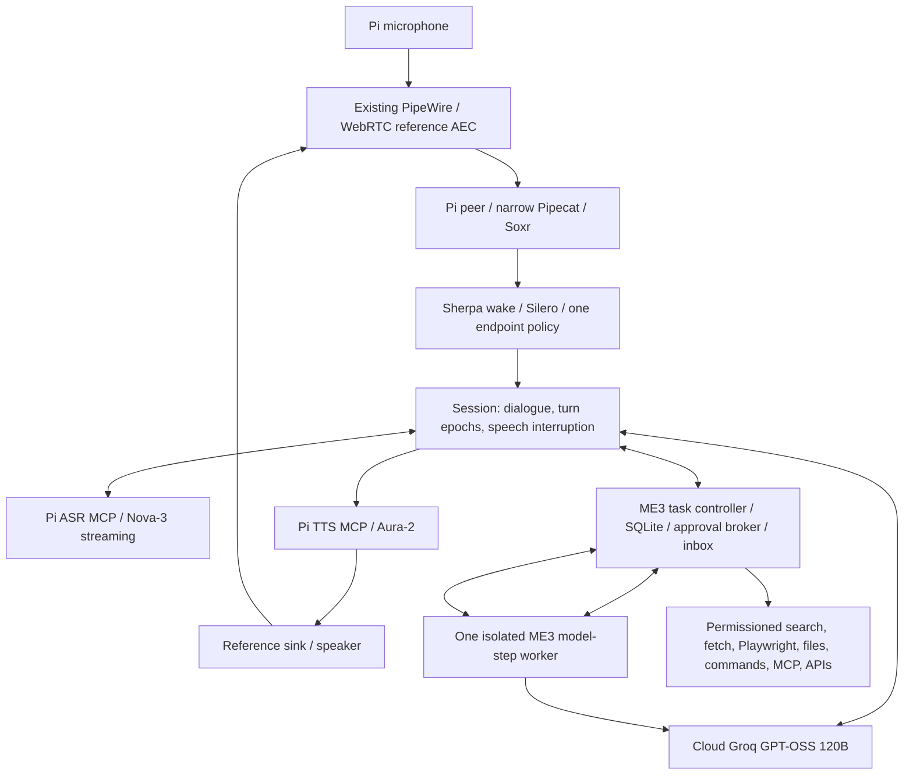

# Post-Phase-1 simplification decision

> **SUPERSEDED:** The final priority correction and source-level replacement map are in [PHASE1_REDUNDANCY_ELIMINATION.md](PHASE1_REDUNDANCY_ELIMINATION.md). This report is retained as decision history; its Session/narrow-Pipecat and custom task executor targets are no longer selected.

Date: 2026-11-09. Architecture review only. This report supersedes conflicting Phase 1 recommendations; it changes no runtime. Phase 0, Phase 1 and their historical evidence were reused. No comparative performance improvement is claimed without a future measurement.

## 1. Converged recommendation

**KEEP simplified Session + narrow Pipecat for voice. Keep Nova-3, Aura-2 and GPT-OSS 120B provisionally. Select one ME3 step executor with SQLite control as the future task path, replacing the nested Onit invocation only after a Phase 5 comparison gate.** This is a design selection, not permission to remove working Onit now. No new agent framework is selected.

Pi hosts the controller, Session, wake/VAD, real AEC capture/render path, both speech MCP servers, task worker, broker and state. Cloud hosts inference and search. Optional HPC Qwen/VPN is an explicitly selected experiment profile; absence must not block baseline readiness. Browser UI is optional for native Pi operation; browser audio remains a separate transport alternative. Native speech-to-speech is deferred because the required separate speech MCP services must do real speech work.

## 2. Voice architecture challenge

Installed source inspected: Pipecat **1.13.0**, `var/cache/venv/lib/python3.13/site-packages/pipecat/`; ME3 `src/me3_voice/harness.py:85`, `session.py:585`, `runtime.py:26`. `PipelineWorker._create_tasks()` starts push/setup tasks; `FrameProcessor` maintains separate normal/system frame processing tasks. ME3 disables turn tracking/RTVI and uses one processor. `SileroVAD` and optional Smart Turn are imported from this same package. Pipecat is not currently a separate process.

| Option | Custom work and ownership | MCP, I/O, resources and migration | Decision |
|---|---|---|---|
| A. Session + narrow Pipecat 1.13.0 | Retains one semantic controller; simplify frontend policy bookkeeping and decouple control receive from input backpressure. Existing ingress module is 237 lines including replay. | Both genuine MCP services and Pi audio retained. Known framework tasks remain; memory/CPU cost has not been isolated. Smallest immediate behavioral migration. | **KEEP/OPTIMIZE — selected.** |
| B. Pipecat-native pipeline, same installed version | Built-in aggregators/turn strategies/interruptible TTS can replace parts of Session only after rewriting custom MCP STT/TTS adapters, delivered-speech history, receipts and UI projection. Keeping Session as well would duplicate owners. | Direct provider services would bypass required project speech MCP servers. Native pipeline still needs those children and PipeWire/AEC. Lower net custom code is possible but unproven; high regression exposure. | **DEFER.** No demonstrated net simplification. |
| C. Lean asyncio Session, no Pipecat ingress | Direct `AudioApplication.feed()` can remove frame runner/completion-future plumbing. Must preserve ordering, cancellation, format validation, deadlines and shutdown fences. | No application-process reduction. Cannot honestly remove the dependency while Silero/Smart Turn imports remain; replacing those means a second migration. RSS or p95 benefit unmeasured. | **DEFER.** Focused direct-ingress A/B only if profiling identifies wrapper cost. |
| D. LiveKit Agents | AgentSession would replace conversation ownership and require MCP speech adapters and local-device integration. Room-oriented transport offers little to the current Pi loopback path. | Console/local modes can avoid a room server; production room topology adds an SFU/service dependency. Not installed, no exact locally qualified version or ARM64 footprint. | **DEFER.** No credible net simplification demonstrated by [current architecture docs](https://docs.livekit.io/agents/). |

The full Session file is 1,938 lines, but its routing, tools, receipts, transcript and playback responsibilities would not disappear merely by selecting a new pipeline. These are source line counts, not maintenance or performance benchmarks. AEC is a capture/render prerequisite for every option. Remove diagnostic endpoint *authority*, not diagnostic evidence. Keep one commit policy in Session and one frontend that proposes turn boundaries.

## 3. Speech provider challenge

No current-tree live speech A/B or first-audible distribution exists. Current adapter presence only lowers integration effort. Vendor accuracy and first-byte claims cannot decide the winner for the intended speaker, accent, room and network.

| Role/candidate | Actual API behavior and benefit | Operational cost / missing evidence | Decision |
|---|---|---|---|
| ASR Nova-3 `nova-3`, `/v1/listen` | Streaming interim and final results; compatible adapter exists. Disable provider endpointing when local endpoint policy commits turns; aggregate provider final segments per ME3 turn, explicit Finalize at commit. | Local endpoint may add delay. Budget $0.0077/min conservatively; public price snapshots disagree on promotion/current rates, account rate must be checked. | **KEEP primary provisionally.** Smallest change. |
| ASR Flux `flux-general-en`, `/v2/listen` | Native turn events and configurable end threshold; may remove local Smart Turn compute and silence endpoint policy. Local VAD remains immediate barge signal; Session still accepts turn IDs. | New protocol/events and stream lifetime; docs recommend 80 ms chunks. Needs receive/push events in MCP, not model-name substitution. Connection/model/network cost and Pi CPU savings unmeasured. | **DEFER replacement; first challenger.** Run alone as endpoint proposer, never stack local completion delay afterward. |
| ASR AssemblyAI `universal-3-6-pro`, streaming v3 | Current model provides partial/final Turn events and transcript-associated SpeechStarted. Strong candidate for entity/context accuracy. | New provider adapter; SpeechStarted waits for transcript, so local stop must not wait for it. $0.45/session-hour base; connection duration billing makes standby policy material. No ME3 accuracy advantage established. | **DEFER.** Evaluate after Flux only if transcript/turn gates still fail; not another production dependency. |
| TTS Aura-2 `aura-2-thalia-en`, `/v1/speak` | Existing WebSocket adapter; Flush/Clear protocol; local sink stops immediately, generation epochs reject in-flight old PCM. | $0.030/1k characters. No measured intelligibility or first-audible advantage. Current adapter must prove Clear/reopen fencing. | **KEEP primary provisionally.** |
| TTS Flux `flux-haley-en`, `/v2/speak` | Streaming PCM, cross-turn acoustic state, Interrupt and text-alignment reconciliation. | $0.045/1k characters (50% higher than Aura-2 before promotions). Requires session-wide playback offset and revised event mapping. Pi duration estimates cannot establish words heard; server text_spoken is conditional on correct offset, not acoustic evidence. | **DEFER.** Test only if audible latency/intelligibility or truncation reconciliation misses gates. |
| TTS Cartesia Sonic `sonic-3.6-2026-08-27` | Stable dated model; WebSocket text continuations, context IDs, per-context cancellation, raw PCM. Independent provider can isolate outages. | New adapter/voice choice; roughly 1 credit/character, dollars depend on subscription and overage. Need one fixed voice ID before test; no invented common per-minute rate. No ME3 listening evidence. | **DEFER.** Credible challenger, not selected fallback yet. |

Primary sources: [Nova endpointing](https://developers.deepgram.com/docs/endpointing), [Flux v2 requirements](https://developers.deepgram.com/docs/flux/quickstart), [Flux features](https://developers.deepgram.com/docs/flux/feature-overview), [AssemblyAI current models](https://www.assemblyai.com/docs/streaming/select-the-speech-model), [turn events](https://www.assemblyai.com/docs/streaming/turn-detection), [AssemblyAI pricing](https://www.assemblyai.com/pricing), [Aura Clear](https://developers.deepgram.com/docs/tts-ws-clear), [Deepgram prices](https://deepgram.com/pricing), [Flux TTS controls](https://developers.deepgram.com/docs/flux-tts/interrupt-handling), [Sonic snapshot](https://docs.cartesia.ai/build-with-cartesia/tts-models/latest), [Cartesia cancellation](https://docs.cartesia.ai/api-reference/tts/websocket), [Cartesia credit policy](https://docs.cartesia.ai/pricing). These are documentation/vendor evidence reviewed 2026-11-09, not independent ME3 benchmarks.

**Fallback policy:** retain at most one ASR fallback, existing Groq `whisper-large-v3-turbo`, final-only and explicitly degraded, activated only on a fresh turn after an outage and parity tests. No automatic TTS fallback selected; expose text/status if Aura is unavailable. Piper remains an optional future offline experiment, not a loaded standby model. Avoid two unqualified live speech adapters solely to claim redundancy.

Nova requires a longer-lived active-engagement stream for useful partials. Do not start a new provider session at every local silence or stream ordinary wake-standby conversations to cloud. Reset/drain provider state explicitly across engagements. Flux/Assembly end events must be carried as proposals through a versioned MCP event contract; otherwise local endpoint + remote endpoint can double the wait. All options retain one speech inference network connection per role and two real Pi speech MCP services.

## 4. Conversational model and task runtime challenge

**KEEP Groq `openai/gpt-oss-120b`, low effort, streaming**, for dialogue and task steps. Existing integration and selected historical artifact successes justify testing it first; they do not prove dynamic research, robust argument validity, multi-turn corrections or cost per independently successful task. Provider throughput (~500 token/s) excludes network, reasoning, tools and verification. Published price remains $0.15/M input and $0.60/M output; report all retries/context/reasoning charges, not only visible output. [Model reference](https://console.groq.com/docs/model/openai/gpt-oss-120b).

Substantive correction: [Groq Structured Outputs](https://console.groq.com/docs/structured-outputs) documents that its strict response-schema mode does not support streaming/tool use. This does **not** remove ordinary streamed tool calling. Validate complete function name/JSON/schema locally, reject unknown tools/extra fields and malformed/truncated arguments before dispatch; permit one bounded repair before failure. Never infer correct arguments from schema-valid prose. Groq [tool calling](https://console.groq.com/docs/tool-use/overview) and ME3's observed role=tool compatibility issue require adapter regression coverage. Bounded read-only concurrency is allowed only by the controller; external effects remain serialized per target.

Keep **Anthropic `claude-sonnet-5-5` as one disabled provisional backup**, not a required service or a second coding model. Current [official catalog](https://platform.claude.com/docs/en/models/overview) lists the identifier and $2/M input, $10/M output; Messages streaming/tool mapping and account entitlements are untested. Its much larger context window does not justify unbounded dialogue. A budgeted matched task comparison must justify enabling it; never reissue effects after switching model. Without qualified fallback, fail visibly while local controls remain available.

Installed Onit metadata is **0.1.5a0**, an editable install mapping to `/mnt/jfs_hpc/home/edgardo.callagon.jr/onit/src`; repository HEAD `3d014cfae043130d956ac042de7142516146e96b`. The inspected chat file was clean relative to that checkout. `src/model/serving/chat.py:3091` accepts an instruction, registry and safety queue; `_await_with_safety` polls stop input; approval helper uses `chat_ui.ask_approval`; read-only tools can run in a batch. Thus upstream has useful controls. ME3 `onit_worker.py:925` instead passes a fresh unconnected safety queue, disables verification/harness tools, and wraps the HTTP client to normalize requests. `onit_tasks.py:327` shields a single whole job. The entry point returns final text, not a durable per-step resumption object. Current limitations are partly ME3 integration, not proof that Onit is incapable.

| Task option | Human control, recovery and code implications | Decision |
|---|---|---|
| A. Existing ME3 provider/tool primitives + SQLite step controller | One model-step interface reused for short/long execution; explicit durable observations, requirements revision, approval/effect journal. Custom checkpoint/IPC/notification code is still necessary. No hidden durable coroutine or second agent loop. Existing `ChatReasoning.respond()` has fixed schemas today and needs generic registry injection; it is not already a complete worker. | **REPLACE future nested task path with this design after a bounded Phase 5 prototype passes parity. Selected architecture.** |
| B. Simplified Onit 0.1.5a0 | Can wire approval/stop hooks; protects prior working artifact path. Still requires an outer durable controller, step export/resume integration and provider compatibility wrapper. No source evidence that the current chat API supplies required durable revisions/checkpoints. | **DEFER as shipping target; KEEP existing path unchanged as baseline/rollback until comparison.** |
| C. OpenAI Agents SDK | Published SDK 0.24.0 source identifies Python >=3.10 and OpenAI 3.x dependencies; docs describe approval interruption/resumption and sessions. No installation/prototype here; main-branch version is not a locally frozen release. Application must still enforce revision-scoped permissions, persist state and reconcile external effects. Groq compatibility adds another parity gate. | **DEFER.** More dependency/state integration without removing the effect controller. Do not nest SDK inside Onit. |

OpenAI evidence: [SDK architecture](https://developers.openai.com/api/docs/guides/agents/sdk), [human review](https://developers.openai.com/api/docs/guides/agents/guardrails-approvals), and [published dependency source](https://raw.githubusercontent.com/openai/openai-agents-python/main/pyproject.toml). Resume/approval support is useful but does not guarantee exactly-once external actions. No additional Deep Agents survey is justified after this concrete comparison.

The selected design removes Onit-specific environment, full-job serialization, SDK monkey-patching and nested reasoning ownership **if** the migration gate passes. Existing Onit integration spans 700 lines in `onit_tasks.py` and 1,047 in `onit_worker.py`; some implement permissions/artifacts and must be preserved or consolidated, so these are not claimed deletable line counts. Worker process count stays one. Expected dependency/code reduction is a source-based hypothesis, not measured RSS/latency improvement. Do not split the 1,938-line Session into another general agent by copying it wholesale.

## 5. Generic research, authorization and execution

**KEEP Tavily Basic plus original-source retrieval and existing Playwright 1.64.1.** No demonstrated retrieval gap warrants Brave/Exa or a second search account. Query generation/refinement remains dynamic, with actual current UTC/local time injected per request. Source records retain URL/redirects, retrieval time, asserted publication time, excerpts/hash and claim links. Search results alone are discovery evidence; retrieve the authoritative page before claiming its contents. Citation presence is not factual verification; compare claim to passage, resolve date/entity ambiguity, and report conflicts. Web content has data authority only and cannot issue instructions to the broker.

Registry entries must bind schema/version, risk class, scope, deadline, size, operation ID, retry and postcondition verifier. One registry is consumed by both conversational calls and task worker; no duplicated website/election tool definitions. Use generic file/code/command/browser/MCP/API capabilities. A broker outside worker authority holds write credentials and checks task revision/approval immediately before dispatch. Reject stale requirements after steering. SQLite persists intent and observed result around each effect; Unknown stays Unknown until reconciliation. Approval must bind argument hash/target/revision/expiry, and replay must not mint fresh operation IDs. Reconnect replays inbox events by cursor without replaying actions; spoken delivery waits for a safe listening pause. Prompt filtering alone is insufficient confinement: OS/filesystem/network limits are a prerequisite to exposing arbitrary commands or account writes.

## 6. Processes, queues and network budget

Correcting Phase 1 arithmetic: native Pi baseline with one task worker is **seven application processes**: bridge/controller (1), speech MCP children (2), task worker (1), Pi peer (1), pw-record/pw-play (2). Existing PipeWire/WirePlumber are additional OS daemons. Browser/tools add explicitly bounded process trees. Pipecat removal alone does not reduce this count; removing Onit's separate environment does not remove the isolation process. Two user service units remain a deployment proposal, not enabled services.

Queue ownership: Session controls turn generation/8 PCM chunks/2 pending text segments; input processor owns bounded PCM backlog; MCP controls provider operation buffering; controller owns durable tasks/outbox and one active worker. Express audio backlog limits in milliseconds, not merely item counts. The current 32-frame ASR queue can hide about one second; a future receive/control split must bound it and surface overload. Keep local interruption and ACKs from waiting behind ASR input puts. SQLite writes are single-writer/off voice loop. No Redis, graph server, routing LLM or always-on Chromium.

Cloud minimum: one Groq endpoint, Deepgram speech endpoints and Tavily only when research is invoked; original pages/external tools are dynamic dependencies. Account access, region latency, concurrency and rate limits remain untested. Voice and task share an LLM provider but use separate request/token budgets with reserved voice capacity. No polling model calls for heartbeat/status. Optional HPC VPN has no readiness edge. Resource budgets in Phase 1 remain targets, not measurements.

## 7. Native realtime compatibility

[OpenAI Realtime](https://developers.openai.com/api/docs/guides/realtime) processes audio directly and owns conversation/tool/audio events; Gemini [Live guidance](https://ai.google.dev/gemini-api/docs/live-api/best-practices?hl=en) similarly exposes interruption behavior. They could reduce a separate inference cascade, but separate project ASR/TTS servers would become transport façades or duplicate inference. They also do not solve local AEC, effect authorization or durable tasks. **DEFER under the present course requirement.** No native-voice proof of concept or speculative cost comparison is justified. Google overview retrieval was partially inaccessible; no detailed model qualification is asserted.

## 8. Evidence gates and prioritized next implementation

Historical E21 scoped project successes remain useful; no independent unseen-task success rate exists. No installed-tree regression was run during this documentation review, and no A/B result, Pi PSS figure or first-audible value is newly measured. Source evidence and official API documentation above support compatibility and effort judgments only. Alpha/preview functionality is not promoted to production. Mutable provider models/prices require metadata capture at benchmark time.

1. **First authorized Phase 2 step:** establish source hash manifest (ME3 remains untracked under parent Git), run current-tree offline regression with all existing tests/default mocks and no provider credentials; classify failures rather than assuming prior logs apply. Preserve baseline outputs. No behavioral edit before this gate.
2. Inventory Pi PipeWire/WebRTC plugin and current device/routing ownership read-only; then obtain attended device-test authorization as required. Preserve ME2 and existing audio services. Route every audible ME3 playback stream through the reference sink; raw microphone and reference/processed captures need correlated samples.
3. Qualify simultaneous capture/playback and AEC with fixed geometry/volume: user-only, assistant-only, noise and double-talk. Measure acoustic stop and first-word preservation. Only then tune interruption persistence; no cloud ASR/harness replacement in Phase 2.
4. Phase 3 compare current 32 ms protocol vs batched contract, and Nova/local completion vs Flux completion with no extra local endpoint wait. Do not preselect 96 ms: batching changes the 32 ms speech contract and may worsen latency. AssemblyAI is a gated third condition if transcript/turn accuracy remains deficient.
5. In Phase 5 compare the selected minimal worker with unchanged Onit using identical model/tools/task corpus and approved budgets. No phase is advanced by this report.

**Minimum A/B and rollback:** use at least 50 matched speech turns and 50 deliberate interruptions per speech change, common replay then attended Pi acoustic trials; measure speech-end/final/first-audible, premature turns, word/entity errors, local loop lag, all-process PSS, cost and failures. TTS uses identical texts, blind intelligibility review and multiple interruption positions; compare request-to-PCM separately from first audible. Keep a change only if correctness gates hold and measured p95/resource improvements exceed run variability, or it provides a demonstrated required capability at accepted cost. Revert on worse wake/ASR/first-word fidelity, stale PCM, loop lag, device ownership conflicts or lost cancellation. Fixed-silence fallback remains until better turn policy passes.

For worker replacement use >=20 unseen multistep tasks, >=30 steering/control sequences and >=20 restart/dispatch crash windows. Must meet existing success thresholds, show zero unauthorized/duplicate effects or stale-revision commits, preserve tool receipts and keep voice responsive. Compare total tokens, repair calls, independently verified cost/success, code/dependency inventory and memory. If it needs more custom policy than simplified Onit or cannot resume safely, do not retire Onit; revise the single runtime decision instead of operating two task harnesses. No automatic data downgrade; rollback retains effect/approval history.

This review changes design documents only. Physical Pi AEC qualification remains mandatory before a full-duplex claim; all Phase 1 numeric targets remain proposed gates, not achieved results.
