# Phase 3 — native speech and application integration

Checkpoint: 2026-11-10. **PHASE 2: PENDING_OPERATOR_VALIDATION. PHASE 3: REPOSITORY_LOCAL_COMPLETE for the authorized opt-in core speech/application integration.** Legacy remains the default and rollback. This does not qualify live models, Pi acoustics, production cutover, or all legacy external-service integrations. No SSH, installation, paid inference, model changes, LangGraph migration, remote push or Phase4 execution occurred.

## Actual application and ownership

`configuration.load_runtime` reads a small strict JSON configuration with `engine` (`legacy` default or `native`) and native `silence_seconds` (default0.5). CLI `--engine` overrides the file. Selection is implemented in actual `cli.mock_conversation` / `replay_conversation` and `voice_bridge.build_app`, not only an experiment. `configs/runtime.example.json` explicitly preserves legacy.

```mermaid
flowchart LR
    C[CLI annotated utterances / file replay] --> N[NativeApplication]
    B[Browser or existing Pi audio peer] <-->|PCM / ACK / controls over loopback WS| W[native_bridge]
    W --> N
    N --> P[PCMPreprocessor once / 32ms admission]
    P --> G[WakeGate: Sherpa admission only]
    G --> V[Pipecat Silero VADProcessor]
    V --> S[McpSTTService]
    S --> U[Pipecat native user aggregator / turn strategy]
    U --> L[NativeLLM: OpenAILLMService]
    L <-->|Native function calls| T[Existing typed mock tools]
    L --> Y[McpTTSService]
    Y --> O[NativeOutput / BaseOutputTransport]
    O --> A[Native assistant aggregator]
    A --> X[One LLMContext]
    X --> U
    O --> K[Memory sink or existing BrowserSink ACK delivery]
    S <-->|SpeechClient / stdio MCP| AS[Project ASR child]
    Y <-->|SpeechClient / stdio MCP| TS[Project TTS child]
    AS -. provisional provider WS .-> DG[Nova-3]
    TS -. provisional provider WS .-> AU[Aura-2]
```



Annotated demo boundaries omit the detector and use complete-utterance EOF with zero additional silence wait, matching the legacy demo. File/browser input uses native Silero VAD plus one native `SpeechTimeoutUserTurnStopStrategy`; Nova server endpointing remains disabled. `--endpoint-ms` describes the legacy detector; native timing is configured through runtime `silence_seconds`. No second endpointing or Session controller runs inside the native path. Wake admission and device preprocessing remain ME3-specific.

| Source / exact responsibility | Implemented state |
|---|---|
| `native_app.NativeState.start/close` | One bridge-lifetime context, real MCP resources and retained LLM request budget; AnyIO enter/exit stays on one owner task. Unexpected reconnect preserves resources/context; a dead initialized MCP owner fails closed and requires bridge restart, preventing budget reset/replay. |
| `NativeApplication._start/register_tools` | Constructs one native pipeline/worker; forwards existing mock tool schemas to framework function execution. Native user/assistant callbacks project status only. Native idle callback controls wake admission; no custom idle timer or second context. |
| `NativeApplication.feed/queue_audio/drain/finish_input` | One PCMPreprocessor, fixed32ms frames, at most16 admitted frames pending; backlog fails closed. Completion futures acknowledge native STT consumption; no extra consumer/audio queue. Final file-tail framing is explicit; truncated active speech is interrupted rather than fabricated into a final. |
| `NativeApplication.interrupt/__aexit__` | Native interruption and recognizer invalidation; generation/key fences reject late finals and stale output. Stop delivery before teardown; speech interruption does not cancel completed or approved task effects. |
| `native_llm.NativeLLM` | Existing installed `OpenAILLMService` owns request parsing, streaming and tool loop. Mock upstream yields SDK chunks; external mode retains configured endpoint/model and request guard. SDK retries and framework timeout retries disabled. Installed SDK HTTP client factory is used; no new HTTP dependency. Live API operation untested. |
| `native_speech.McpSTTService` | Real project MCP append/partial/final/cancel adapter; ordered commit, asynchronous finalization, bounded cleanup and stale-result fencing. Partial polling only during append-idle periods;32ms default retained. |
| `native_speech.McpTTSService` | Real MCP streaming, bounded text operations, native context-tagged audio and cancellation. Framework text aggregation and output scheduling replace Session segmentation/playback orchestration. |
| `NativeOutput.write_audio_frame/push_frame/stop_delivery` | Framework output queue/scheduler; existing sink handles delivery. Wait for outstanding browser ACKs before committing assistant text/stop to native context. Generation fences prevent cancelled text/audio reentry. Native output packets default40ms; ASR packets remain32ms. |
| `native_bridge.build_native_app/context_view` | Actual loopback browser entrypoint, single active connection, existing origin/host checks and BrowserSink wire protocol. Read-only bounded transcript projection, compatible capability/status/event fields and snapshot route; no duplicate dialogue history. Optional music telemetry is validated but performs no service action. |
| `voice_bridge.BrowserSink` | Retains bounded8-packet ACK transport. Added generation check after capacity waits and before send, preventing a blocked old packet from escaping after audio_stop. This also strengthens legacy rollback. |
| `cli.py` / `voice_bridge.py` | Lazy legacy imports; fresh native CLI test verifies `me3_voice.session` is not imported. Explicit engine configuration; no automatic fallback to a second orchestrator. |

Native browser supports core conversation/ACKs/interruption and in-memory reconnect continuity. Explicit Stop clears context and session identity; unexpected disconnect retains them, without replaying completed actions. This is not durable recovery. Onit, real-device configuration, receipts, direct-clock and diagnostic-audio options are rejected in native mode. Spotify, physical-device UI, task artifacts and recording-lab routes are explicitly unbound; unavailable integrations return errors rather than invoking Session. Core voice mock device tools remain available. Legacy provides its existing integrations until later authorized work.

## Processes, queues and dependencies

Core voice: one application process/event loop plus two functional project speech MCP child processes/event loops, two stdio MCP connections. No nested Pipecat ingress worker, Session playback worker, task worker, extra socket or new dependency is added to native core voice. Framework processor/transport queues remain. Native adds an MCP lifetime task, a pipeline runner, browser publisher, bounded admission futures, and per-operation ASR final/partial tasks. Existing BrowserSink ACK map is retained, not another playback controller. Framework/provider SDK threads and executor threads are runtime-dependent; sampled per-process threads are in results, not asserted as fixed.

Mock tests/benchmarks make no provider calls. Live deployment adds ASR/TTS provider WebSockets and LLM HTTPS requests with existing backend configuration. Browser WS remains loopback. The existing Pi sidecar, PipeWire helpers and acoustic reference graph are still required for current physical bridging; an in-process physical adapter is not qualified and the sidecar is not removed. Optional HPC is not required. LangGraph has not been installed or migrated.

Dependency definitions/lockfile remain unchanged (Pipecat1.13.0, MCP2.3.0). Entry-point integration scope (`cli`, `voice_bridge`, `configuration`, `native_pipeline`, new `native_app/native_bridge/native_llm`) adds **1,328 physical lines /9 classes /57 function definitions** relative to experiment024 baseline; nonblank/noncomment line delta1,205. This is staged coexistence, not a demonstrated final code reduction. Experiment023 previously added440 application lines in its separately declared speech scope; do not confuse either scope with whole-project totals.

## Tests and failures

Before application changes: **506 passed in119.46s**. Full integrated working tree: **520 passed in182.98s**, no skips, one installed-framework `AudioContextTTSService` deprecation warning. Ruff checks pass for the added/changed native modules and benchmark. Checkpoint code snapshot: **509 passed,3 optional wake-asset skips in171.45s**, one framework warning. Unpublished unrelated VPN tests are excluded; private wake assets are absent. Documentation results were finalized after this run, with runtime/test source unchanged. Full checkpoint manifest/logs are under `var/results/phase3-entrypoint-checkpoint/`.

Fourteen entrypoint cases cover strict config/default/override, real CLI legacy/native tool conversations, actual browser continuity/reconnect, bounded blocked-write cancellation, delayed actual MCP ASR final cancellation, ACK-gated stale-text prevention, same-connection ASR timeout recovery, CLI replay dispatch, partial-start cleanup/retry, retained live-request authorization guard without an API call, explicit Stop versus disconnect, dead MCP owner fail-closed and browser capability/status/optional-telemetry contracts. Actual project MCP subprocesses run; only upstream inference and detector boundaries are mocked. Existing speech adapter tests additionally cover true append/partial/final streaming, completed-but-delayed result fencing, generator cancellation, concurrent ASR/TTS, bounded cleanup, and forwarded new onset before blocked cleanup.

Preserved failures: early entrypoint checks found tool-demo assumptions, installed SDK `httpx2` compatibility, and an event-field collision; corrected and retested. `entry-seventh-tests.log` contains3 output-path failures because `/tmp` was used instead of the documented `var/` basetemp; the corrected full invocation passes. No failed result was relabeled as a pass. Protocol tests do not establish microphone/browser acoustic performance or live function-calling accuracy. A separate actual-dashboard Chromium smoke attempt could not launch because the installed Playwright package has no browser executable; no installation was attempted. Its script/log remain under experiment024. Rendered-browser validation remains pending; HTTP/WS schema coverage does not replace it.

## Matched application benchmark

Results: `var/results/architecture_modernization/phase3-entrypoint-{legacy,native}.json`. Source hashes frozen and verified per run; source/complexity inventory also saved. Each engine runs in a fresh sequential process with identical1024-sample reused16k PCM,51 turns (first warm-up excluded), existing MockLLM, real project speech MCP, immediate memory sink. Both endpoints are explicit complete utterance EOF with **no extra silence floor**. Mock speech text/tone inference is not recognition or intelligibility evidence. No tools are invoked in this latency workload; tool behavior is covered by regression cases. Percentiles use nearest upper order statistic; no comparative significance claim.

| Metric, ms unless stated | Legacy p50 / p95 | Native p50 / p95 |
|---|---:|---:|
| Endpoint → ASR final, n50 | 3.795 /5.860 | 1.314 /1.633 |
| Endpoint → first memory output, n50 | 7.729 /10.107 | 6.298 /8.885 |
| TTS-open → first PCM, n50 | 2.641 /2.947 | 1.995 /2.458 |
| ASR append RPC, n102 | 0.969 /1.171 | 0.807 /0.975 |
| Steady event-loop lag, n95 /105 | 0.182 /0.695 | 0.215 /0.613 |
| MCP calls per measured turn | 12 /12 | 12 /12 |

First-output markers straddle an immediate memory-sink invocation (legacy before, native after). Native40ms versus legacy32ms output packaging/padding differs. These observations do not prove a physical response-speed improvement. No batching change is justified: retain32ms; previous64/96ms slice trials reduced call counts but not measured provider/device latency.

Startup after benchmark-hook imports:4.780s legacy /4.263s native, one sample each; startup heartbeat max878.4ms /173.7ms. Remaining lazy imports/setup differ; these are diagnostic startup observations, not controlled cold-launch distributions. Steady max8.780ms /2.394ms; heartbeat10ms, resource samples100ms. Main-process CPU totals0.945s /1.256s include setup/teardown and are not steady-state CPU utilization.

Maximum sampled sums with all3 processes present: legacy PSS224,308KiB/RSS281,948KiB; native PSS260,283KiB/RSS317,532KiB; sampled swap0. **Native sampled memory is higher**, not a Pi efficiency win. Private framework queue introspection is benchmark-only: observed legacy input3/playback1; native admitted1, pending ASR bytes0, observed processor queue depths up to3. Sampled peaks are not hard bounds, full-duplex stress results, or whole-host/Pi memory measurements. No physical/cold-model/loaded-task resource gate passes from these results.

Historical speech-slice benchmark (`phase3-final-benchmark.json`, experiment023) reported native first-write p95~63.05ms versus Session15.34ms with an explicit50ms native fixture floor. It remains valid for that configuration but is **superseded for matched application comparison** by the equal-EOF benchmark above. Its paced replay, batching/serialization costs, partial-event/concurrent-finalization tests, LLM mock segmentation timing and resource evidence remain useful within their declared limitations. Live LLM TTFT, speech-end/first-audible and provider token/cost metrics remain unmeasured.

## Exact eventual removal inventory and gates

The native path already bypasses these; deletion is NOT authorized or performed:

| Legacy source | Replacement / eventual deletion boundary |
|---|---|
| `session.Session` (1,354 lines /33 functions) | Native context aggregators, `OpenAILLMService`, framework callbacks and turn strategy replace history/turn/LLM lifecycle. `begin_input/push_input/commit_input/recognize/recognize_stream/respond/reasoning/interrupt/tick/exit` no longer run in native. Preserve/migrate service policies, task receipts and external integrations before whole-class deletion. |
| `session.Playback` (75 lines /6 functions) | NativeOutput/BaseOutputTransport replaces enqueue/run/stop/close and its bounded playback queue; BrowserSink ACK delivery remains necessary. |
| `runtime.AudioApplication` (90 lines /5 functions) | NativeApplication hardware preprocessing/admission plus native detector/turn pipeline; no second FrontendMonitor/VAD/Session wiring. |
| `audio.ConversationInput` /`ReplayInput` (147 /83 lines) | Native turn/interruption plus WakeGate replaces source endpoint state, barge window and custom finish orchestration in native. Keep independent readiness/diagnostic uses until callers migrate. |
| `harness.StreamingInputProcessor/PipecatAudioInput/SessionProcessor` (59 /115 /11 lines) | Direct native pipeline input removes nested ingress pipeline, request futures and Session dispatch layer. Remove only after remaining legacy/diagnostic callers migrate. |
| `remote.ChatReasoning` (632 lines /6 functions) | NativeLLM/OpenAILLMService replaces custom SSE/tool request loop for native. Existing typed policy/validation/provider behavior still needs live parity before deletion. Other remote speech adapters remain. |
| Session runtime state/queues | `State`, Turn/key lifecycle, `input_queue(max32)`, response segment queue, ASR/response tasks and Playback queue are unused in native; native frame/context identity, turn controller and output cancellation own these functions. Do not delete shared TurnKey/tool security contracts. |
| Legacy bridge orchestration /Pi sidecar | Legacy service coordination and Session lifecycle can retire after native bindings parity. BrowserSink/security/UI projection and project MCP servers remain. Pi sidecar and PCM socket retire only after actual in-process physical I/O/AEC parity; no source-only test substitutes for that gate. |

Class line spans overlap broader feature ownership and are deletion ceilings, not a promise to delete all their logic or an additive final saving estimate. Current native and legacy paths are alternatives, never stacked. Explicit mock tool effects are not a substitute for future approval enforcement/durable verification.

## Reproduction, rollback and remaining gates

```bash
mkdir -p var/results var/scratch
PYTHONPATH=src PYTHONDONTWRITEBYTECODE=1 NUMBA_CACHE_DIR=var/cache/numba OPENBLAS_NUM_THREADS=1 OMP_NUM_THREADS=1 \
  var/cache/venv/bin/python -B -m pytest -q --basetemp=var/scratch/pytest-phase3-review
PYTHONPATH=src var/cache/venv/bin/python -m me3_voice.cli demo --engine native --output var/results/native-demo-NEW.json
# Run separately and sequentially, changing ENGINE and NEW output each time:
PYTHONPATH=src PYTHONDONTWRITEBYTECODE=1 OPENBLAS_NUM_THREADS=1 OMP_NUM_THREADS=1 \
  var/cache/venv/bin/python -B scripts/benchmark_application_entrypoint.py --engine ENGINE --samples 50 \
  --output var/results/entrypoint-ENGINE-NEW.json
bash scripts/phase2/qualify_audio.sh --help
```

Recorded run also supplied private `reference-reading-16k.wav` under experiment022; omit `--wav` to use synthetic contract PCM and label the difference. Fresh output paths prevent evidence overwrite. Parent HEAD remains9338bc2; source manifests are authoritative until the local checkpoint. Raw logs and rollback originals: experiment023 and024. Local checkpoint uses cached shared origin/main4475722 and an isolated Git index; preserves parent HEAD/index, ME2 and unrelated VPN work. No remote publication is authorized.

Immediate rollback: restart CLI/bridge with `--engine legacy`, overriding any native config. Legacy source remains; keep the BrowserSink stale-packet fix. Source rollback must compare manifest hashes and restore only reviewed changed paths; never reset/clean the parent repository or delete raw results. A default cutover/deletion requires native external-service policy parity, authorized live-provider streaming/error/limits/accuracy tests, and physical speaker/reference-AEC/full-duplex/cancellation/load qualification. Native generic external LLM support currently requires a standard `/chat/completions` endpoint; other protocols fail configuration explicitly.

Phase2 repairs remain offline-qualified only: explicit diagnostic WAV filenames without `--raw`, readiness/countdown cues, teardown-first capture cancellation, failure cleanup and EOF/timeout/device regressions. Original Pi `IncompleteReadError` cannot be classified from recreated teardown alone. Speaker silence, left-channel routing, audible AEC reference, echo leakage and real barge-in remain unresolved. Future attended `qualify_audio.sh` must stop on inaudible physical/reference probes before smoke; preserve recordings/graphs/resource logs and return them for analysis. Existing recordings remain reusable for future authorized provider evaluations; no replacement voice collection is requested now.

Next authorization decision: physical Phase2 qualification when available and separately budgeted live Phase3 providers, or repository-local Phase4 dynamic research/context/tool-policy work. No automatic Phase4, LangGraph or production cutover. Phase3 is repository-local complete within the explicitly supported core entrypoint scope, not physically or fully live-service validated.
