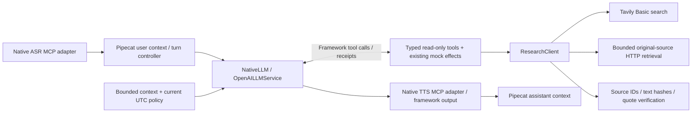

# Phase 4 — native conversational intelligence

2026-11-10. Repository-local implementation and evaluation preparation; **live quality/provider qualification remains pending**. Legacy is still default and rollback. Phase2 remains **PENDING_OPERATOR_VALIDATION**. No Phase5/LangGraph, Pi SSH, installation, paid inference, external writes, commit or remote push was performed.

## Baseline and preserved work

Current working tree was compared with local checkpoint `codex/me3-native-application` / `e9c2911`. Onit's completed changes were a truthful engine field in legacy capabilities, native wake-description parity and two tests. They were retained; the Qwen implementation contract describes Phase3 closure, not an implemented Phase4. No competing writer/subagent was used. Unrelated VPN work and parent Git state were preserved. Baseline:522 tests passed in177.68s; one installed-framework deprecation warning. Experiment025 holds before-source copies and source hashes; parent HEAD9338bc2 is not the ME3 source revision.

## Ownership and exact implementation



Pipecat still owns context aggregation, LLM request/tool sequencing, turn detection, interruption and TTS/output scheduling. No new planner, classifier, secondary conversation history, queue, model call, task worker or durable-state owner is introduced. ME3 code is limited to policy, permissions, provider observation, source provenance and entrypoint projection.

| Source | Responsibility |
|---|---|
| `conversation_context.runtime_time/prepare_context` | Actual aware UTC clock, optional IANA timezone lookup. UTC does not require timezone assets. Refresh policy on **every** model request using native `system_instruction`; not a stale startup date or deprecated system message in history. Retain at most12 recent complete user-turn groups under60,000 serialized characters including policy. Drop old groups whole, preserving tool-call/receipt groups; fail closed if latest group exceeds budget. No summarizer model or second history. |
| `native_llm.NativeLLM` | Installed Pipecat `OpenAILLMService` and existing SDK handle SSE/function JSON. Groq endpoint/model retained: `openai/gpt-oss-120b`, low reasoning effort, sequential tool requests, max2048 completion tokens, reasoning excluded from API response. No strict response-schema mode or native provider web-search side channel. Streaming remains incremental. |
| Same — `get_chat_completions/observe` | Retained bridge-wide authorization/request budget, max6 model requests and8 tool dispatches per user turn;32,000-character response guard. First-token timing and reported usage events; epoch fence and stream closure. Unknown complete `[S#]` citations are rejected before their marker is forwarded, with only a possible split citation buffered (<24 characters), not a whole answer. Empty, truncated, token-limit and malformed tool streams fail explicitly. |
| Same — `run_function_calls/push_frame` | Framework parses tool arguments. If malformed JSON makes it silently discard a call, compare admitted tool indexes with parsed calls and reject before any dispatch. Attach immutable response epoch/tool-continuation metadata to native end frames; no replacement tool loop. |
| `conversation_tools.schemas/validate_arguments` | Seven declared capabilities with exact keys, types, ranges/enums and bounded strings. Reject bool-as-integer, unknown keys/names and whitespace-only required fields before execution. Native framework handlers dispatch calls; no domain classifier/fixed query/action workflow. |
| `native_app.NativeApplication.register_tools` | Bind read-only functions to the native tool loop, native8s tool timeout and interrupt cancellation. Structured safe errors permit model-driven argument repair within budget. Dispatch generation is inherited through Python ContextVar in framework-created tasks: even a late-starting read handler is rejected, while an already-dispatched noninterruptible mock effect retains its stable operation identity. Epoch mismatch suppresses stale callback delivery. Existing mock effects remain noninterruptible/idempotent through their existing executor; speech interruption is not task cancellation. |
| Same — native assistant callbacks | Fix an integration defect: a tool-only/model intermediate response is not a completed user turn. Only a current, non-tool-continuation native response-end after ACK delivery marks completion/returns single-mode to standby. Pipeline failure sends native interruption and exposes symbolic error codes; no automatic inference retry. |
| `research.ResearchClient` | One lazy aiohttp session, read-only search/retrieve/verify, bounded source records and shared bridge-lifetime request accounting. No new process or MCP server. Native research permissions persist across reconnect; explicit Stop clears conversation but does not reset service request allowances. |
| `configuration.RuntimeOptions/ResearchOptions` | Native runtime `research: {allow_live:false, request_limit:0}` defaults fail closed. Strict boolean and integer0..100. Every HTTP attempt, including redirects/failures, reserves allowance before I/O. No quota refund or automatic retry. |
| `credentials.py` / `.env.example` | Add only `ME3_RESEARCH_TAVILY_API_KEY` to explicit project secret-file allowlist/template. No automatic secret-file/account discovery; existing private-file checks unchanged. Environment use is limited to this named key. |
| `cli.mock_conversation` / native bridge | Pass runtime options through actual native CLI, replay and browser binding. Native capability reports research permission/budget; legacy default and unrelated integrations retained. |
| `scripts/evaluate_native_conversation.py` | Default writes a prepared, unexecuted40-case JSONL manifest with null scores. Live flag plus enabled backend budgets required for actual model evaluation; ASR/TTS must remain mock through genuine MCP. Incremental results, answers, events/source records and request counts require independent review. No model grades itself. |

## Research and grounding boundary

Registered new functions: `get_runtime_time(timezone?)`, `web_search(query,max_results?)`, `retrieve_source(url)`, `verify_evidence(source_id,quote)`. Existing `set_mock_light/read_mock_light/run_device_action` remain simulation only. No filesystem/shell/browser/external-write capability is registered. Tool/web content cannot grant a capability or change an endpoint/credential/budget.

Tavily Basic uses one fixed search endpoint, max5 leads, no generated answer/raw-content expansion/automatic parameter selection. Search leads are explicitly untrusted and do not receive source IDs. The LLM chooses/refines queries dynamically. Retrieval follows at most3 redirects before the final request, validates each public HTTP(S) URL and actual resolved connection address, rejects private/link-local/loopback/reserved hosts, credentials, unusual ports and local domains. The aiohttp connector uses this resolver (not a separate preflight DNS lookup), disables DNS caching/proxies/cookies, requests identity encoding and disables decompression. Unsupported encodings/content types and bodies over128KiB fail closed. TLS validation remains enabled. No authenticated scraping or JS execution.

HTMLParser extracts bounded text/title, suppressing script/style/template/noscript data. At most16 source records with8,000 text characters each are retained: final URL, retrieved UTC, bounded title/text, reported Last-Modified and SHA256 of the exact stored text. Search publication dates and HTTP Last-Modified remain **reported metadata**, never assumed event/publication truth. `verify_evidence` tests an exact whitespace-normalized quote against that stored source and returns URL/hash plus `claim_truth_verified:false`.

These are deterministic transport/provenance protections, **not a proof that every model claim is factual**. Prompt-injection text remains untrusted data; the model may still answer poorly or choose an irrelevant source. Known `[S#]` presence is not entailment or source authority. Bare URLs/nonstandard citation syntax are not a comprehensive hallucination filter. Already delivered speech cannot be retracted if a later citation/stream error appears. Live relevance, claim support, source independence and conversational quality must be reviewed separately. No vendor benchmark substitutes for these ME3 gates.

## Provider compatibility evidence

Targeted official references checked2026-11-10: [Groq compatibility](https://console.groq.com/docs/openai), [model identifier](https://console.groq.com/docs/model/openai/gpt-oss-120b), [local tool calling](https://console.groq.com/docs/tool-use/local-tool-calling), [reasoning controls](https://console.groq.com/docs/reasoning), [Tavily search wire API](https://docs.tavily.com/documentation/api-reference/endpoint/search). These support API configuration, not observed ME3 speed/quality. Installed source: Pipecat1.13.0 `services/openai/base_llm.py`, `services/llm_service.py`, universal context aggregators and service settings; SDK3.35.1. No new SDK/framework or dependency lock change.

`configs/native-speech.provisional.json` now fills the former mock LLM placeholder with the already-selected Groq ID/endpoint; all three roles remain `allow_live:false,request_limit:0`. Nova-3/Aura-2 IDs are unchanged. No existing private configuration was touched. Backup-provider auto-switch remains deferred until a separately authorized provider is configured/qualified; after partial output/tool effects, blind replay is unsafe. Current failures are surfaced and future explicit requests can recover; no hidden retry/spend.

## Evidence and remaining gates

Baseline/final regressions, mock latency/resource results, exact failures and commands are summarized below after completion and in ignored machine-readable results. Test layers are distinct:

- Unit/isolated policy: clock/date rollover and missing timezone assets, whole-group trimming/oversized current input, strict tool/config arguments, private URL/DNS rejection, bounded retrieval, redirects, provenance/quote matching, source eviction, no research quota bypass, split/unknown citations, stale streams/callbacks and closed/error streams.
- Actual SDK/native/MCP: loopback HTTP sends fragmented SSE/tool JSON through the real SDK and Pipecat parser. Invalid typed arguments return a structured error; the fixture model repairs them, searches, retrieves, verifies, answers and follows up with timezone context. Both project speech MCP children run mock upstream. This validates wiring, **not Groq reasoning quality or Tavily availability**.
- Actual SDK failures:503 and malformed argument JSON fail without repeat dispatch/request, followed by successful fresh user-turn recovery in the same native pipeline. A generic SDK exception is sanitized; request budgets survive reconnect as before. Existing speech partial/final, ACK ordering, ASR delay, barge-in/late-result and legacy tests remain required.
- `tests/fixtures/phase4_questions.json`:40 varied temporal/research/context/safety inputs, prepared only. No live answers or semantic success rate has been produced. Target remains40+ independently assessed questions, >=90% factual correctness, >=95% supported factual citations, zero invented sources/unauthorized capabilities, and actual network TTFT measurement under approved budget. Those thresholds are **not passed** by fixture tests.

Physical microphone/speaker, reference AEC, acoustic barge-in and Pi resource gates remain pending independently. Rendered Chromium validation also remains pending from Phase3 (browser executable absent); no install was attempted. LangGraph/durable task steering/restart recovery, write approvals and real tool effects remain later-phase work, not capabilities implied by these read-only tools.

## Reproduce and rollback

```bash
mkdir -p var/results var/scratch
PYTHONPATH=src PYTHONDONTWRITEBYTECODE=1 OPENBLAS_NUM_THREADS=1 OMP_NUM_THREADS=1 \
  var/cache/venv/bin/python -B -m pytest -q --basetemp=var/scratch/pytest-phase4-review
PYTHONPATH=src var/cache/venv/bin/python -B -m me3_voice.cli demo --engine native \
  --output var/results/phase4-native-demo-NEW.json
PYTHONPATH=src var/cache/venv/bin/python -B scripts/evaluate_native_conversation.py \
  --output var/results/phase4-evaluation-pending-NEW.jsonl
# Mock-only latency benchmark, no research/model network calls:
PYTHONPATH=src OPENBLAS_NUM_THREADS=1 OMP_NUM_THREADS=1 var/cache/venv/bin/python -B \
  scripts/benchmark_application_entrypoint.py --engine native --samples 50 \
  --output var/results/phase4-native-benchmark-NEW.json
```

New outputs must be fresh. Recorded benchmark uses the same private64ms PCM segment as Phase3; omit `--wav` for synthetic input and label that difference. Live use requires a separately approved request budget, ignored private backend/runtime copies, appropriate project keys and explicit live configuration. The evaluation runner does not enable any allowance automatically; its live flag is not permission for this coding session to spend. Operator review must compare sources and clock/date answers independently; do not count pending manifests as successful evaluations.

Immediate rollback: restart with `--engine legacy`. Native research can be independently disabled with `research.allow_live:false/request_limit:0`; model selection remains in backend config. For source rollback compare experiment025 hashes and restore only reviewed changed files, preserving Onit's capabilities fix, unrelated VPN files, all private results and parent Git state. The Phase3 local checkpoint remains e9c2911; Phase4 is uncommitted unless explicitly authorized later.

## Completed repository-local checkpoint

Final full suite: **559 passed in195.49s**, no skips, one pre-existing installed Pipecat `AudioContextTTSService` deprecation warning. Baseline522;37 added Phase4 cases. Focused native iteration passed54 checks before final stream guards; prior full552/558 checks passed before the final dispatch-generation case. Retained early failures: a Phase3 test stub returned a string rather than an SDK stream (updated to exercise the actual new wrapper); a loopback fixture was rejected by the production private-HTTP policy (fixed by a test-only SDK destination override, **not** weakening endpoint restrictions); premature turn completion during tool chaining; deprecated system-context prompt usage (replaced by native service settings). All final relevant tests pass. Only configuration.py whitespace formatting followed the final full run; AST equivalence was checked and recorded in post-test-format.json. Raw logs: experiment025.

Source accounting versus captured baseline: **+676 physical application lines, +5 classes, +30 function definitions** across changed/new source modules; no production legacy deletion. Dependency definitions/lock unchanged. Core voice remains3 processes/3 event loops/two speech MCP connections. Research adds a lazy HTTP session and the loop's standard DNS resolver/executor on actual use, not a service or worker. Framework/native queues remain; no duplicate audio/controller queue is added.32ms ASR retained.

Canonical mock benchmark: `var/results/architecture_modernization/phase4-native-qualified.json`; source hashes checked unchanged during run. Same private1024-sample PCM as Phase3,51 explicit-EOF turns with first warm-up excluded, real local MCP, immediate memory output, existing MockLLM. No research traffic or live model invocation. Context now intentionally retains12 recent groups; this workload is not a long-memory/semantic quality score.

| Stage, ms | p50 | p95 | n |
|---|---:|---:|---:|
| Endpoint → ASR final | 1.336 | 1.490 | 50 |
| Endpoint → first memory output | 6.647 | 17.924 | 50 |
| Mock LLM request → first token | 0.148 | 0.162 | 50 |
| TTS-open → first mock PCM | 2.023 | 2.530 | 50 |
| ASR append RPC | 0.829 | 0.972 | 102 |
| Steady10ms heartbeat lag | 0.190 | 0.637 | 114 |

12 MCP calls/turn remain. Single startup diagnostic3.721s; startup lag max166.09ms, separate from steady max3.509ms. Main CPU total1.095s includes setup/teardown. Maximum sampled sum of three-process PSS260,855KiB/RSS318,568KiB; sampled swap0;25 three-process resource snapshots.10ms queue observations peak5 in sampled framework queues, native admission1 and pending ASR bytes0. These are development-host samples, not hard bounds, Pi measurements or acoustic output. Startup excludes initial benchmark/controller imports. Native output still40ms versus ASR32ms. Mock first-token time is not Groq TTFT.

Earlier Phase3 native first-memory-output p95 was8.885ms; Phase4 is17.924ms in the final source-bound run. Earlier Phase4 runs before the dispatch fence were16.376ms and17.067ms; all raw results are retained. Report both: **no latency improvement claim**. This is not a randomized paired performance comparison; response-completion signaling and context/policy handling changed, shared-host/scheduler effects remain. The benchmark validates bounded local overhead/call count and preserves a tail-latency concern for realistic provider/Pi trials. Do not change audio frame size to hide it.

Status: **Phase4 REPOSITORY_LOCAL_COMPLETE for the authorized native context/read-only research integration; LIVE_QUALIFICATION_PENDING**. Phase2 remains PENDING_OPERATOR_VALIDATION. Current source is uncommitted and hash-inventoried relative to the522-test baseline; no Git state was changed. Next work requiring authorization is budgeted live Groq/Tavily evaluation and independent40-question scoring; physical audio qualification remains separate. No automatic Phase5 advancement.

## Four-case live pilot attempt — 2026-11-11

**Outcome: ABORTED BEFORE CASE 1.** Both project keys loaded from the secure file. Preflight configuration validated Groq `openai/gpt-oss-120b` with live enabled and a12-request cap; Tavily live was enabled with an8-request cap; ASR/TTS were configured as mocks. The runner created its metadata record and printed the selected host/model/limits. During `NativeApplication` startup, the local project-owned speech MCP client failed its MCP `initialize` handshake with `MCPError: Request 'initialize' timed out'` inside `SpeechClient.__aenter__`. The case loop had not begun. There are zero case records and no `model_requests_used` field, consistent with failure before any utterance/model/search call. **Groq requests: 0. Tavily requests/credits: 0. Speech inference requests: 0.** No factual claims were generated to verify. Latency and quality metrics are unavailable. No provider error, billing requirement, budget overrun, or external action was observed. The failed output is preserved at `var/results/architecture_modernization/phase4-live-pilot-20261111.json`; machine-readable classification is `var/results/architecture_modernization/phase4-live-pilot-outcome.json`.

Failure classification: configuration schema/keys/caps passed; local speech MCP startup/integration failed; LLM reasoning, web tool behavior, factual grounding and attribution were not exercised. The exception occurred while entering the application resource stack, before evaluation. It does not indicate a Groq/Tavily outage. The runner's current JSONL artifact misleadingly begins with `LIVE_API_REQUESTED_UNVERIFIED` before requests occur; treat that value as intent/attempt metadata, not evidence that inference was sent.

**Required fixes before retry:** add a mock-only startup preflight for both ASR and TTS MCP servers that records service name, subprocess exit status/stderr and initialize duration; make startup readiness failure identify the failing service; keep the live evaluator's first provider request strictly after that preflight; and preserve a terminal aborted/error record on startup failure. Re-run only the local mock-backed MCP/application regression first. After it passes, rerun this same four-case pilot within the unchanged12/8 caps. Do not increase the caps or begin the 40-case/multi-step live evaluation until this failure is resolved and the pilot results are independently assessed.

## Four-case live pilot retry — 2026-11-11

**Outcome: STOPPED AFTER CASE 2 because Groq returned HTTP429 `provider_rate_limited`.** The original account no-charge conditions were confirmed by the user and reused. The live runner executed outside the restricted sandbox. Before starting the app, the new mock-only preflight started ASR and TTS independently through their real stdio MCP protocol. ASR:2.121s, exit0, protocol `2025-11-25`, all required tools, empty stderr. TTS:2.074s, exit0, same protocol, all required tools, empty stderr. Preflight makes no inference calls. The full application then started with its real MCP services and mocked speech inference.

The first case, P4-02, completed in1.634s with two Groq requests,0 Tavily searches and answer “November 11, 2026, 11:58 am Asia/Manila.” Its trace timestamp is03:58:59Z (11:58:59 local), so date and rounded minute are correct. This is directly checkable against runtime time; no external citation is necessary. First-token times were1.036s and0.499s. The transcript/playback path was mocked, so this measures software pipeline execution only.

P4-11 generated a research query and retrieved one result, then fetched an original source at `https://www.ecb.europa.eu/ecb/decisions/html/cvlagarde.en.html` (title “Christine Lagarde”, retrieved03:59:04Z; excerpt truncated at8KB). The model failed on its next completion with Groq HTTP429; no answer was emitted. Case elapsed5.496s; successful request TTFTs0.612s and1.305s before the failed fifth attempt. Therefore there is no response to grade for correctness or claim attribution. Search/retrieval itself worked; the official ECB URL is a plausible primary source, but the source record is truncated and the query/result relevance cannot be fully judged from the final transcript.

**Usage:** 5 Groq request-budget attempts (4 succeeded, then one429); successful usage events total6,305 prompt and181 completion tokens. The adapter excludes the rejected request body/usage headers, so its token consumption is unknown. One Tavily basic search consumed1 credit (Tavily documents basic search at1 credit); one subsequent original-page GET is counted by ME3's research operation counter but is not a Tavily API request/credit. Thus Tavily used1 of8 API requests, not2. The previous field `tavily_requests_used` actually counts all research HTTP operations; that label is misleading. No other APIs/actions were invoked. Both later cases P4-12/P4-17 were skipped.

The error is a provider rate-limit/quota failure, not a billing prompt or local integration failure. The exact quota dimension is unavailable because the adapter intentionally excludes the provider response body and rate-limit headers. Groq currently documents model-specific limits, including TPM; prompt volume was6,305 tokens over this short two-case burst, so TPM pressure is plausible but **not confirmed**. No retry was attempted. The run is not a completed four-question quality evaluation.

### Root cause and fix for MCP startup failure

The first pilot was launched inside the managed sandbox. That environment restricts AnyIO's local subprocess/pipe IPC used by stdio MCP. The MCP initialize handshake timed out before a case ran. Running the exact ASR/TTS subprocesses in the authorized unsandboxed HPC command path succeeded independently with exit0, protocol discovery and empty stderr. This identifies the cause as execution-environment IPC restriction rather than a service/provider defect. No protocol was bypassed and no startup timeout was weakened.

Implemented `preflight_mock_speech`: it only accepts mock ASR/TTS specs, checks each child separately via the same MCP initialize/list-tools/capabilities path, measures elapsed startup, captures exit code and bounded/redacted stderr, and records protocol/tools/errors. The live evaluator writes both service results before entering the case loop and records `ABORTED_PREFLIGHT` on failure; app-start failure also creates an explicit record. The evaluator stops after a runtime/provider error. The initial runner label was changed from implying an API call had occurred to `LIVE_PILOT_ATTEMPT_PRECHECK_REQUIRED`.

Focused regression:3 preflight tests passed (both services, injected ASR process exit17 with stderr while TTS still passes, and rejection of non-mock speech); Phase4/native app regression52 passed with one existing Pipecat deprecation warning. Ruff passed on changed files. No test made Groq/Tavily requests.

**At that checkpoint, the following fixes were pending; this recommendation is superseded by the cumulative continuation below.** (1) classify and retain safe provider rate-limit headers such as remaining token budget and retry-after, while still excluding API keys/body secrets; (2) give pilot cases an explicit delay or use lower per-call token limits/context to keep bursts within free TPM, without retrying the failed request; (3) rename the research counter to distinguish Tavily searches from original-source HTTP retrievals and add it to per-case records; (4) preserve a result-level terminal status when evaluation stops early. Then authorize a fresh, source-frozen pilot run. Do not resume this run, exceed the12/8 caps, or start the 40-question/multi-step evaluation. Phase6 has not started.

Raw attempt: `var/results/architecture_modernization/phase4-live-pilot-20261111.json` (startup-aborted first attempt). Retry with preflight and partial answers: `var/results/architecture_modernization/phase4-live-pilot-20261111-retry01.json`. Classified measurements: `var/results/architecture_modernization/phase4-live-pilot-outcome.json`.


## Cumulative pilot continuation — 2026-11-11

**Outcome: PARTIAL; stop before P4-12/P4-17.** Resumed only P4-11/P4-12/P4-17. ASR/TTS preflight passed again (ASR2.000s, TTS1.885s, exit0, protocol `2025-11-25`). No provider 429 occurred in this continuation. P4-11 ran for120.013s and timed out with no final answer. Five Groq requests succeeded (16,241 prompt and411 completion tokens after deduplicating duplicate Pipecat usage events). The model/tool sequence was search, retrieve, search, retrieve, search: five research HTTP operations total, comprising three Tavily search calls and two direct source fetches. No source was retained in the result, so factual correctness or attribution could not be graded.

The safe headers from successful Groq responses reported `x-ratelimit-limit-tokens: 8000` and `x-ratelimit-limit-requests: 1000`; the last response showed3,332 tokens and995 requests remaining. Groq documents token limit as TPM and request limit as RPD; these successful responses show neither of those windows exhausted during this continuation ([rate-limit header definitions](https://console.groq.com/docs/rate-limits)). No 429 recurred, so the new instrumentation did not capture a failure response. The earlier 429 response was not persisted with headers/body, so its quota dimension remains **undetermined**. The earlier burst makes TPM plausible, but RPM or another restriction cannot be excluded; Groq's documented headers do not expose a separate RPM counter. Do not attribute the original 429 to TPM as a confirmed cause.

Across both live attempts: **10/12 Groq attempts**, of which the continuation's five succeeded; **4/8 Tavily search attempts** (estimated four basic-search credits), plus three direct-source HTTP fetches. The existing ME3 `ResearchOptions.request_limit=8` counts searches and direct-source retrievals together; cumulative combined research operations are7/8, leaving one. This is stricter than the authorized Tavily-only cap but currently blocks further source-grounded cases. Only two Groq attempts also remain, insufficient for reliable search→retrieve→answer chains for both cases. P4-02 remains passed; P4-11 remains incomplete; P4-12 and P4-17 were not run. No account upgrade, other provider, Pi access, or unrelated external action occurred. Billing review relied on the user's prior free-tier/no-auto-overage confirmation; provider dashboards were not independently inspected.

### Rate-limit handling and tests

`NativeLLM` now retains only an allowlist of Groq retry/rate headers, parses reset durations, and classifies a 429 as likely token-window or daily-request exhaustion only when the corresponding documented remaining counter is zero. RPM remains unidentifiable from these headers. It retries a 429 at most once, only when provider reset guidance is present, at most30 seconds, and the original request cap has room; every attempt consumes the same cumulative allowance. A 2.1-second request floor is combined with latest token remaining/reset headers. If headers are absent, it falls back to an estimated prompt-token spacing. The first implementation spaced each request by the previous prompt's estimated share of TPM even when remaining-token headers were ample; the120s timeout exposed that this added avoidable turn latency. It was corrected to wait for token reset only when the provider-reported remaining budget is below the prior prompt estimate plus10%. This corrected pacing is locally tested but not yet live-qualified.

The evaluator now preloads prior attempt counters, supports pending-only case files, distinguishes Tavily search attempts from total research HTTP operations, and writes a terminal record. Tests: **4 focused rate-limit/header/pacing/retry tests passed** after the pacing correction. The broader Phase4/native-entrypoint suite passed **54 tests** before that final pacing adjustment; Ruff passed after all changes. Tests use mock/loopback providers, not paid inference.

No answers from this continuation meet independent-review requirements. The existing cumulative request controls are now the blocker; do not reset counters or resume under a larger limit. Next work should be a separately authorized pilot budget/config decision that keeps the original Groq/Tavily ceilings and distinguishes search calls from source fetches, plus a bounded per-question tool-call policy or better task timeout handling. Phase6 remains unstarted. Raw continuation: `var/results/architecture_modernization/phase4-live-pilot-20261111-continuation01.jsonl`; cumulative classification: `var/results/architecture_modernization/phase4-live-pilot-outcome.json`.


## Research execution reliability review — 2026-11-11

### What the failed P4-11 trace establishes

The continuation run ended with `TimeoutError` at the evaluator's explicit120s `wait_for(app.settled.wait(), 120)` boundary. The runner then interrupted the conversation and wrote `RUNTIME_FAILURE`. Before timeout it recorded five successful Groq responses, three `web_search` handler completions, two `retrieve_source` handler completions, and zero retained sources. It did not produce an answer. The actual trace did not record tool success/error codes, arguments/fingerprints, tool-result callback completion, or the next LLM context's tool messages. Its `tool_completed` event meant only that ME3's handler returned; it did not mean the result succeeded or was retained.

The installed Pipecat1.13.0 source shows the native lifecycle: `OpenAILLMService` parses a streamed function call; `LLMService.run_function_calls` invokes the registered ME3 callback; `params.result_callback(result)` broadcasts a `FunctionCallResultFrame`; `LLMContextAggregatorPair` matches the tool-call ID, updates the existing tool placeholder in the shared `LLMContext`, and triggers the next LLM run for a final nonempty result. ME3 search/retrieval results and symbolic errors are nonempty dictionaries. Existing actual-SDK tests, and a new deterministic local-MCP scenario, confirm the next request contains those tool results. **No framework context/result-delivery defect was reproduced.**

What remains unknown is why the two source retrievals in the live continuation left no retained source. `ResearchClient.retrieve` retains an item only after the HTTP response passes status, content type, parse and nonempty-text checks; `NativeApplication` turns a `ResearchError` into a symbolic `{ok:false,error:...}` result. Either retrieval may have returned such an error, but the old trace discarded that distinction. The first partial attempt did retain an ECB source before its later Groq429, so retrieval is not categorically broken. The exact retrieval error and whether the model saw it in P4-11 cannot be recovered from those artifacts. Repeated live call arguments were also not recorded, so identical-call looping is unproven.

The timeout itself is proven. The earlier pacing implementation inserted delays proportional to each previous prompt's share of TPM even when the response header showed thousands of tokens remaining. The P4-11 first-token event intervals included roughly10–38s pacing. Combined with repeated tool cycles, this could consume the120s turn deadline; the precise share of timeout attributable to pacing versus provider/tool work was not separately measured. The pacing rule was changed to wait for token reset only when reported remaining tokens fall below the previous prompt estimate plus10%. This is unit-tested, not live-qualified.

### Changes

- Tool events now record an opaque hash of tool name/arguments, identical-operation count, success, symbolic error, result kind/count, retained source count, and return from Pipecat's result callback. The next `llm_context_ready` event reports tool-call/result counts, structured tool error counts, retained source count and context trim count. Raw query, URL, source text, result bodies and credentials are not logged. This distinguishes handler completion, callback delivery and later context presence without replacing Pipecat's aggregator.
- Runtime configuration exposes validated `max_model_calls_per_turn` (default6, allowed1–12), `max_tool_calls_per_turn` (default8, allowed1–8), and `max_repeated_tool_calls` (default2, allowed1–4). A repeated operation is keyed by a SHA256 digest of canonical tool name/arguments. Different research queries remain allowed; the same operation can run twice to allow one recovery attempt, and a third identical call returns a structured error without executing. Global tool/model caps remain bounded.
- On a turn that used research tools, final factual text is buffered until completion and emitted only if it contains a citation to a currently retained source ID. Unknown citations, missing sources, or an uncited answer are withheld and replaced by a concise explicit failure streamed through Pipecat and the project's TTS MCP. This adds final-answer latency for research turns, not ordinary conversational turns. It verifies citation identity/existence, not semantic entailment; `verify_evidence` remains an exact-quote check and is not a complete truth verifier.
- Model-call budget exhaustion now returns a terminal generic failure stream instead of raising before a response frame, and the application emits `turn_failed` with a reason while settling the user turn. The native evaluator records that state distinctly from a normal answer.

### Reproduction and validation

The new deterministic scenario uses the real project ASR/TTS MCP stdio services with mock inference. Its scripted LLM searches, receives an untrusted lead, attempts a source fetch that returns a symbolic failure, repeats the same search, then tries an uncited factual answer. Assertions verify the source-fetch error and repeat-block result appear in the subsequent `LLMContext`; the third identical search is not executed; no source/citation is invented; only the explicit failure is spoken; and terminal state is `turn_failed`. A separate successful local SDK/MCP fixture continues to prove source retrieval, exact citation IDs and legitimate multi-step research work.

After the main fixes: **594 tests passed, one pre-existing Pipecat deprecation warning,256.04s**. The final terminal-state reset was then verified by the Phase4/native subset: **57 passed**, one same warning. Ruff passes for all changed Python files. Focused six-case Phase4 research/rate/pacing subset passed; no live network, Pi access or paid calls were used. Exact machine result, source hashes, commit and environment: `var/results/architecture_modernization/phase4-research-reliability.json`.

### Live-pilot decision

A new live pilot is **not justified yet**. The source-result lifecycle is now diagnosable and mock scenarios show correct failure behavior, but the original P4-11 retrieval errors cannot be recovered, the revised response buffering/pacing has no live latency measurement, and only2/12 Groq attempts and1/8 aggregate research HTTP operations remain under the existing app counters (the Tavily-only count is4/8). Do not reset or increase these limits. Resolve the counter semantics and obtain a new explicitly bounded pilot authorization before further live requests. No P4-11 answer is claimed; P4-12/P4-17 remain unrun; Phase6 remains unstarted.

## P4-11 single-case live canary — 2026-11-11

**Outcome: RUNTIME_FAILURE after the 120.015s case deadline; no answer.** This run used the explicitly authorized new allocation only: mock ASR/TTS, the real project speech MCP stdio services, Groq `openai/gpt-oss-120b`, and Tavily. Before live execution, the existing project venv passed the focused startup/integration suite (**71 passed**, one existing Pipecat deprecation warning), and separate ASR/TTS MCP preflight returned exit0 for both services, protocol `2025-11-25`, expected tools and empty stderr. An attempted sandboxed test run failed because this sandbox denies loopback socket binding and stdio child-process IPC; the same suite passed unsandboxed. No dependency was installed.

### Observed research failure

The first Tavily search returned leads. The model selected the Wikipedia ECB-president page, not an original ECB source. Its retrieval returned the structured error `research_http_failure` (the retrieval adapter records a non-200 response symbolically; the exact HTTP status is not retained). The tool result callback returned and the next Pipecat context contained that error, so loss of tool results is not the cause. The model then made two more distinct searches; all three search operations had different opaque fingerprints and each had identical-operation count1, so the exact-repeat guard correctly did not trigger. Each search result still had retained-source count0. A later source-retrieval call was rejected with `research_disabled_or_budget_exhausted` before network I/O because the four-operation new allocation had been consumed. No source was retained at termination.

The persisted event stream contains five tool callback returns and shows subsequent contexts with tool-result counts1 through5. The failed retrieval and budget-denial errors were present in those contexts. Search snippets remained untrusted leads. The final model continuation never returned an answer, so there was no citation or factual claim to independently grade. **No grounded answer was produced and no citation is claimed.** The claim in search snippets that Christine Lagarde leads the ECB was not independently verified in this run.

### Request, token and latency record

- This run used **5 successful Groq attempts** (no HTTP/provider errors), **3 Tavily search attempts**, and **4 combined research HTTP operations** (three searches plus one failed direct fetch). The attempted retrieval after the cap was blocked before HTTP. Cumulative totals are **15/16 Groq** and **11/11 combined research operations**; Tavily search attempts total **7**. The remaining one Groq attempt is not authorized for another case and will not be spent.
- Deduplicating repeated Pipecat usage events by prompt/completion token pair gives **17,406 prompt tokens and268 completion tokens** in this canary. There is no dollar-cost assertion; provider account billing state was not independently inspected.
- First-token times for the five successful model responses were **1.002, 0.470, 2.179, 46.391 and33.557 seconds**. These begin before provider pacing and include pacing plus provider response time, so they are not provider-only TTFT. Headers progressed from 6,578 to1,465 remaining TPM tokens; the last token-reset hint was49.012s. The final sixth model continuation entered `llm_request` but produced no provider rate header, usage event or authorized request before the 120s timeout. The request counter remained15. Its `llm_first_token` never arrived. Pacing delay itself is not emitted as a dedicated event, so its exact duration is unavailable; the two long TTFTs and reset headers are consistent with long reset waits but do not isolate them.
- Tool handler latencies were2.712s,0.164s,2.578s,2.398s, and effectively0s for the final pre-network budget rejection. End-to-end case duration was120.015s. Startup time is excluded from the per-case timer, and these are HPC/live-provider measurements, not Pi performance.

### Decision and remaining limitation

The previous hypothesis that no tool continuation reached Pipecat context is disproven for this run. The specific observed failure chain is: a non-200 Wikipedia retrieval; query refinement through three distinct searches; no available operation allowance for the next retrieval; then a model continuation delayed at pacing until the evaluator timeout. The exact HTTP status and exact pacing sleep durations were not persisted. The canary also demonstrates that exact-operation deduplication does not bound semantically similar but textually distinct query drift; model-call and total research-operation caps did bound spend. No code or architecture was changed during the canary. Preserve the failed result rather than retrying it under the exhausted 4-operation allocation. Before any future live research authorization, consider recording pacing-wait duration and ending a turn explicitly when research budget prevents the requested source retrieval. No further live call, budget expansion, P4-12/P4-17 run, Pi access or Phase6 work occurred.

Full restricted result: `var/results/architecture_modernization/phase4-live-p4-11-canary-20261111.jsonl` (mode0600). Compact safe summary and raw-result hash: `var/results/architecture_modernization/phase4-live-p4-11-canary-summary.json`.

## Research reliability and efficiency fix — 2026-11-11

Confirmed from the P4-11 trace: the first retrieval returned a symbolic non-200 HTTP failure, all five tool results reached later Pipecat contexts, three searches had distinct argument fingerprints, no source was retained, and the final continuation entered pacing before the 120s evaluator timeout. The prior adapter discarded the HTTP status. The trace cannot establish the precise status, semantic reason for model source choice, or exact pacing sleep duration.

Implemented in the existing native path:

- `ResearchError` now returns a bounded symbolic code, numeric HTTP status and opaque host hash. Timeouts and transport errors are separately classified. URL, response body, headers and credentials stay out of tool error results. The original P4-11 status cannot be reconstructed retroactively.
- Search results are explicitly marked `discovery_only`; snippets are capped at320 characters rather than2,000. This removes at most8,400 characters per five-result search from each later context without trimming retrieved-source text. Prompt-token savings are an estimate, not a measured live result.
- The existing system instruction now prefers the issuing institution or author for original-source requests and asks for a different primary-source lead after a failed fetch. This is a general model instruction; it does not prove future provider choices.
- When no source has been retained, the native tool boundary reserves the last allowed research HTTP operation for retrieval, returning `retrieval_budget_reserved` for another search. Exact-operation repeat limits and global model/tool budgets remain. Different queries can still be explored while retrieval budget exists.
- The native turn has a110s local deadline with12s reserved for response. It checks pacing delay before authorizing an external model request, records a terminal reason if the delay would overrun the reserve, and bounds streaming inference by the same deadline. Terminal failures use the Pipecat speech path. The evaluator's120s outer timer remains a final safety boundary.

Deterministic offline tests: safe HTTP status/redaction, compact discovery leads, retrieval reserve, pacing-before-request termination, and a delayed model through both real project MCP services. The latter settled with an explicit failure and no late unsupported text. Focused unit tests4 passed; focused MCP/SDK integration tests3 passed; full existing-venv regression **598 passed**, one existing warning,256.32s. Ruff passed. No paid inference, external research, Pi access or Phase6 work. Machine record: `var/results/architecture_modernization/phase4-research-fix-offline.json`.

Citation scope remains bounded to retained source IDs; identity and retrieval do not prove semantic entailment. `verify_evidence` checks an exact quote only. Search leads cannot become citable sources, and no citation is manufactured when retrieval fails. A further single-case live canary is diagnostically useful only under a new explicit request allocation; it is not authorized here and would not by itself qualify broad research accuracy.

## P4-11 canary allocation 02 — 2026-11-11

One authorized run stopped on terminal grounding failure after5.746s. Mock ASR/TTS and both project speech MCP servers passed preflight. Tavily made1 search and the original-source fetch succeeded, retaining official ECB page S1 at `ecb.europa.eu`. The extracted 8,000-character text contained the page title and navigation but no body claim identifying Christine Lagarde as ECB president. Thus the primary-source choice was good, HTTP retrieval succeeded, but the retained evidence did not support the requested answer. The LLM returned no usable citation; the citation guard spoke its explicit no-guess response. No fabricated citation or unsupported answer was delivered.

Usage:3 successful Groq requests (6,491 prompt /149 completion tokens, duplicate usage events deduplicated),1 Tavily search,2 combined research HTTP operations. First-token measurements were0.844,0.713,0.813s; elapsed time5.746s. Cumulative ceilings were19/19 Groq and13/14 research operations; search count8. The run stopped on terminal failure with one Groq and one research operation remaining. No further requests were made. This confirms a content-extraction defect rather than the prior HTTP retrieval failure or loop/timeout path. Minimal fix: extract semantic `main`/`article` content and remove navigation/footer boilerplate before truncating; cover long-navigation pages with an offline fixture. Current authorization did not include implementation or another canary. Independent review record and raw hash: `var/results/architecture_modernization/phase4-live-p4-11-canary-allocation02-review.json`.

## Generic HTML source extraction update — 2026-11-11

The P4-11 official ECB profile was fetched successfully, but its extracted 8,000-character prefix contained the title/navigation rather than the relevant evidence. Updated the existing standard-library HTML parser to exclude common chrome and scripts, prefer `main`/`article` content, and apply the text cap only after extraction. Non-semantic pages use visible non-boilerplate fallback text; title-only, empty, and common JavaScript-rendering placeholders fail as `insufficient_source_content`. Source URL, title, timestamp and content hash remain attached; truncation now describes extracted content.

Added four representative HTML fixtures: long navigation before article, structured content, empty article, and JavaScript-rendered placeholder. Focused extraction/provenance tests:6 passed. Full existing-venv regression: **602 passed**, one existing Pipecat deprecation warning,255.30s. Ruff passed. No provider calls, dependencies or site-specific rules were added. Limit: this remains a lightweight HTML parser and cannot execute JavaScript or guarantee semantic relevance on every site. P4-11 raw traces and counters were not modified.

## Adaptive retrieval optimization — 2026-11-11

Implemented a bounded retrieval flow in the existing ResearchClient/Pipecat tool path:

- Tavily Basic Search remains the default (up to five results); snippets are concise and explicitly discovery-only. Results sort by lexical query relevance, generic institutional host signals (.gov/.edu/.int), then provider score. This is a lightweight preference, not an authority guarantee.
- Search and source retrieval use a process-local LRU-style cache with a300s TTL and32-entry cap; repeated identical searches avoid another request. Full retrieved content remains in bounded source memory for provenance and exact-quote checks.
- Local semantic HTML extraction runs first. Tavily Basic Extract is a single optional fallback only when local HTML has inadequate meaningful text; Advanced Extract is not used. Text/plain sources bypass the HTML word threshold. Every remote request consumes the existing shared research request budget.
- Before the source tool result enters LLM context, a simple query-term sentence ranker selects up to2,400 characters. Full extracted text and source URL/title/hash remain in source memory. Search snippets alone remain non-citable; when retrieved evidence is inadequate, the existing citation guard fails closed.

Offline comparisons: a73,700-character HTML fixture with long navigation produced200 extracted characters and one200-character relevant excerpt, with0 network requests. A repeated identical search generated1 mock HTTP request total. Basic Extract fallback generated1 mocked HTTP request after local extraction failure. Four HTML fixture classes cover long navigation, structured content, absent article body and JavaScript-only placeholder. Focused retrieval set9 passed; full existing-venv suite **605 passed**, one existing warning,253.02s; Ruff passed. Machine record: `var/results/architecture_modernization/phase4-adaptive-retrieval-offline.json`.

No live p95 latency, Groq token reduction, Tavily credit use, provider source quality, or semantic retrieval accuracy was measured. Tavily Basic Extract is budgeted as one ME3 HTTP operation; its provider credit rate was not independently verified. The lexical excerpt selector is not a semantic reranker. Deeper multi-source work remains possible within existing tool/model/request caps. Search results are not reused as citations because they remain leads; this deliberately costs a source retrieval when answer grounding requires evidence. A further live canary is warranted after the offline changes to assess primary-source relevance, Basic Extract incidence, tokens and latency, under a separately approved budget. No live requests, budget changes or Phase6 work occurred.

## Autonomous intelligence reliability offline checkpoint — 2026-11-11

Reviewed current policy, Pipecat tool routing, existing adaptive ResearchClient, LangGraph task boundary and prior P4-11 evidence. Strengthened general contextual instructions to use runtime time, resolve “latest” by event type/date, distinguish preliminary from confirmed outcomes, and clarify only when ambiguity changes the answer. Discovery snippets remain non-citable; a fresh factual answer requires retrieved evidence under the existing guard. Existing lexical excerpt selection, local extraction, cache and optional Basic Extract fallback remain in one ResearchClient; no router, agent, dependency or process was added.

Reproducible offline evidence: full suite **605 passed**, one pre-existing Pipecat warning,252.28s; Ruff passed. Existing adaptive retrieval measurements remain fixture-only:73,700 HTML characters→200 extracted/source excerpt characters; identical search: one mocked HTTP call for two calls; Basic Extract fallback: one mocked call. No post-change live tokens, provider credits, end-to-end voice latency or physical Pi measurements are available. Search snippets are deliberately not treated as citable; this may use an additional retrieval operation but avoids unverified claims. Record: `var/results/architecture_modernization/phase4-autonomous-reliability-offline.json`.

Status: Phase4 repository-local behavior is offline-tested; live research/factual quality remains unqualified. Phase5 remains conditionally qualified as previously reviewed. Phase2 physical audio remains pending operator validation. No live APIs, budget changes, Pi SSH or Phase6 work occurred.

## Native application intelligence and latency validation — 2026-11-11

### Assessment: CONDITIONAL

No production intelligence defect was demonstrated by the deterministic application run. A narrow testability gap was found: `NativeApplication` did not expose `NativeLLM`'s already-supported clock injection. Added an optional `clock` argument and passed it through; production remains on the real system clock. This enables reproducible frozen-time checks without changing route or response behavior.

Added `tests/test_intelligence_application.py`, which runs six consecutive turns through the real `NativeApplication`, Pipecat worker/context/tool lifecycle, mock upstream transcript model, both project-owned ASR/TTS MCP stdio servers, and mock TTS memory playback. The routes exercised were stable direct answer, ambiguous election clarification, context-bearing current-election follow-up with search/retrieval, ECB extraction failure, conflicting retrieved evidence, and a historical 2024 question. Search and page HTTP were deterministic mocks; the ECB case reuses the no-article fixture. LangGraph delegation and concurrent voice responsiveness remain covered by the existing `test_native_voice_mcp_remains_responsive_while_durable_task_runs` integration test.

The scripted provider selects the routes and outputs in advance. Passing proves that Pipecat carries the chosen route through MCP, tool results, retained context, citation gating, TTS and completion. It does **not** prove Groq would select the right route, that its answers are accurate, or that general temporal policy is followed. In the election follow-up, the test confirms conversation context reaches the provider and the app executes one search plus one retrieval; the source and response are synthetic fixtures, not actual election facts. The 2024 response is likewise a scripted contract case. In the ECB regression, local extraction retained no source and the app replaced the attempted unsupported claim with “I couldn't verify this answer from a retrieved source, so I won't guess.” The conflicting-source case retained both distinct source texts; the scripted answer cites each and explicitly leaves the conflict unresolved. This checks citation identity and source contents, not automatic semantic entailment.

### Measurements

Evidence class: **offline deterministic mock on HPC**, Python3.13.9, Pipecat1.13.0. The ASR/TTS MCP servers were actual local child processes; LLM, search, webpage responses, ASR and TTS inference were mocked. Startup is separate from turn response. The six response samples measured 20.0 ms median and 28.6 ms nearest-rank p95 (n=6; p95 is the maximum at this sample size). First memory PCM was 15.9 ms median /23.4 ms maximum. Stage medians / maxima: ASR-final 0.84/1.48 ms, LLM mock first token 0.12/7.44 ms, mock TTS first PCM 2.58/5.21 ms. Native app startup was3.74s and includes MCP and task-runtime initialization. These are local software/mocked timings, not live inference, audible response, a production p95 claim, or Pi performance. No event-loop lag, CPU/RSS, acoustic latency or provider cost was measured.

The six-turn fixture used13 model requests,7 tool calls,3 search operations and4 retrieval attempts; mock provider cost was$0. Serialized context sent to the mock totalled34,460 characters, about8,618 chars-per-four estimated tokens across requests (heuristic only, not provider-tokenizer usage). The largest single turn issued4 model requests and3 tool calls and carried17,356 characters cumulatively across those requests; no repeat loop occurred. Searches were absent for direct, clarification and historical scripted routes. A failed ECB retrieval terminated with the explicit source-grounding response. Machine-readable per-case timings, context sizes, source hashes, revision and limitations: `var/results/architecture_modernization/intelligence-offline.json`.

### Before/after and remaining qualification

Before this evaluation, the current-tree baseline was **605 passed**, one existing Pipecat deprecation warning,251.95s. After the clock seam and new app-level scenario, the complete existing-venv regression is **606 passed**, same warning,261.01s. The one-test increase is the new evaluation; there is no measured answer-quality or latency improvement to compare because no prior identical workload was recorded and no runtime behavior change was made. Ruff check/format validation passes on changed Python files. Full-tree Ruff check still reports four existing E401 multiple-import findings in unrelated files; full-tree format check reports ten pre-existing files would be reformatted. Those files were not changed.

The offline tests establish application plumbing, deterministic evidence handling, and fail-closed output only. The exact next meaningful live test is a fresh, explicitly authorized, small paired evaluation using the configured Groq model and Tavily: unseen questions across direct/stable, temporal-current, historical, ambiguous/follow-up, source-conflict and insufficient-evidence classes; record the model's chosen route, source URL/body evidence, answer/citations, token usage and stage timing, then independently grade against sources. Previous live request ceilings are exhausted; do not reuse or reset them. Real voice latency additionally requires physical Pi microphone/speaker/AEC qualification, which remains `PENDING_OPERATOR_VALIDATION`.

## Four-question live intelligence canary — 2026-11-11

### Outcome: stopped after significant fresh-research failure; Phase4 remains CONDITIONAL

The authorized run used the native Pipecat application, Groq `openai/gpt-oss-120b`, Tavily Basic when selected, and both project-owned ASR/TTS MCP stdio services with mock inference. Before live execution, **68 focused native-entrypoint/Phase4 tests passed**; independent ASR/TTS MCP preflight succeeded (exit0, protocol2025-11-25). The operator confirmed free-tier use and paid overages disabled. No external writes or Pi access occurred.

| Case | Result | Evidence |
|---|---|---|
| INT-01 — SI unit of electric current | **PASS** | Answered “ampere (A)” directly; no search; correct stable fact. 1 Groq attempt,1.03s,1,248 prompt/35 completion tokens. |
| INT-02 — “What is the rate now?” | **PASS** | Asked what type of rate was meant; no search; appropriate clarification. 1 Groq attempt,1.68s,1,278 prompt/54 completion tokens. |
| INT-03 — clarified latest Bank of England Bank Rate | **FAIL (safe termination)** | The model made two searches and two source retrieval attempts. Both retrievals returned `research_http_failure`; nothing was retained. No factual answer/citation was delivered. After98.86s elapsed in the case, the response-reserve guard emitted `turn_deadline_reached` before the 110s hard turn deadline. |
| INT-04 — contextual previous-rate follow-up | **NOT RUN** | Correctly skipped after INT-03's significant failure; no retry of completed cases. |

INT-03's first search mixed a secondary UK Parliament lead and older Bank of England page results. The model then refined its search to a Bank of England query for the 5 November 2026 decision and attempted two source retrievals. Search refinement was directionally appropriate; it did not produce usable primary-source evidence. The exact retrieved URL and HTTP status were not preserved in the case artifact, only the symbolic retrieval error, so the underlying HTTP cause remains unknown. Search snippets are not treated as source evidence. No factual correctness or citation-support score is possible for INT-03 because no answer or retained source exists. The explicit terminal response avoided a fabricated claim.

### Usage and latency

New allocation used **7/12 Groq attempts,4/6 combined research HTTP operations, and2/6 Tavily Basic searches**. Final cumulative totals are **25/30 Groq,17/19 combined research operations, and10/14 Tavily searches**. The remaining allocation was not reused. Deduplicated Groq usage was **16,278 prompt and383 completion tokens** (16,661 total); failed retrieval attempts were not Groq errors. Tavily usage was two Basic Search attempts (approximately two Basic credits under the existing one-credit estimate); direct source fetches are included in the combined ME3 research counter but not Tavily request count. Billing dollars were not read from the provider dashboard; the operator's free-tier/no-overage confirmation is recorded.

Completed-case wall times: INT-01 1.03s, INT-02 1.68s, INT-03 98.86s. INT-03 Groq first-token observations for five provider responses were1.987,0.657,40.213,1.458 and46.149s; these include ME3 pacing and are not provider-only latency. Two long continuations dominate the stalled research case. The terminal fallback was local and did not consume another Groq request. No audible-output timing, CPU/RAM, event-loop lag or Pi measurement was collected. Do not interpret three mixed-case samples as a representative p95.

### Runner defect and final assessment

The preserved raw JSONL incorrectly labels the stop as `STOPPED_CUMULATIVE_GROQ_BUDGET`, although the counters show five Groq attempts and two research operations remained in the new allocation. The actual stop was the terminal `turn_deadline_reached` case failure. Fixed the evaluator's terminal-status mapping after the run and added a focused regression (**1 passed**); the raw run artifact was left unchanged. Corrected review summary: `var/results/architecture_modernization/phase4-live-intelligence-canary-summary-20261111.json`; raw output: `phase4-live-intelligence-canary-20261111.jsonl`.

**Phase4 is not live-qualified.** Direct answering and clarification passed, but fresh research failed to retrieve the primary source, the answer could not be verified, and the contextual follow-up was not exercised. The exact next action is an offline diagnosis of why the two public-source HTTP fetches failed and an instrumentation fix to preserve safe HTTP status/host classification in evaluator results; then a separately authorized retry is needed. No retry, Phase6 work or additional live request was made in this run.

## Retrieval diagnostics and fast failure guard — 2026-11-11

### Confirmed source-level defects and limits

The prior canary artifact preserved only `research_http_failure`. `ResearchError.result()` already included numeric HTTP status and an opaque host hash, but `NativeApplication.register_tools()` projected `tool_completed` down to the error code, result kind/count, and retained-source count; this is why the evaluator trace lost status and host classification. Separately, `ResearchClient.read()` collapsed DNS, TLS, connection, permission/network-policy, and body-read failures into `research_transport_failure`. `PublicResolver` reported blocked addresses without safe host context. `_tavily_extract()` suppressed all errors and returned an empty string, making a failed fallback indistinguishable from a successful-but-empty extraction. The old live trace did not preserve enough data to infer which HTTP status or URL actually failed; the exact P4-11 cause remains **unknown**.

### Changes

- `ResearchError` now carries bounded stage/failure classifications, numeric HTTP status, an opaque host hash, redirect count, local extraction status, and optional Basic Extract outcome. No exception text, credentials, URL path/query, response body, or response headers are returned.
- HTTP errors remain distinct from DNS resolution, TLS certificate/handshake, timeout, connect/refusal, route/permission restriction, response-body read, unsafe redirect, and extraction failure. Non-public resolved addresses now include only a host hash and policy classification.
- Local HTML extraction remains first. Tavily Basic Extract still runs only when local content is insufficient and within existing request limits; its status distinguishes disabled/unconfigured/budget-exhausted, empty/insufficient/invalid response, success, and structured failure. Insufficient webpage content is not labeled a transport failure.
- `tool_completed` retains an allowlisted diagnostic projection, source origin and full-URL hash (never its path/query), plus extraction method/evidence status. The live UI's runtime status dialog shows the last source origin and safe HTTP/extraction result.
- After two failed `retrieve_source` operations in one conversation turn, Pipecat's next continuation returns the existing explicit uncertainty response locally without sending another LLM request. One failed retrieval still permits a different-source recovery attempt. The ceiling resets with the turn; search/tool budgets and citation rules remain unchanged.
- A pre-existing pending-manifest test now writes beneath ignored `var/results/`, matching the evaluator's existing output-location policy.

### Offline evidence

Using the existing project environment, focused `tests/test_phase4.py`: **62 passed**, one existing Pipecat TTS deprecation warning. This includes deterministic DNS/TLS/timeout/network restriction and HTTP status classification, fallback-failure versus insufficient-content behavior, source retention and error diagnostics through the actual Pipecat application, two failed retrievals ending without a fifth model request, and functional project ASR/TTS MCP subprocesses. Relevant Ruff checks and format checks pass. Full regression result is recorded in `BENCHMARKS.md` after this checkpoint.

No API call or live latency test was made. The two-failure guard is a bounded fail-closed policy; offline evidence proves that it prevents additional model requests after the threshold, not that a live Groq answer will be faster by a particular amount. A new live canary is not warranted by this implementation task and still requires explicit separate authorization. Phase4 remains `REPOSITORY_LOCAL_COMPLETE / LIVE_QUALIFICATION_PENDING`.
