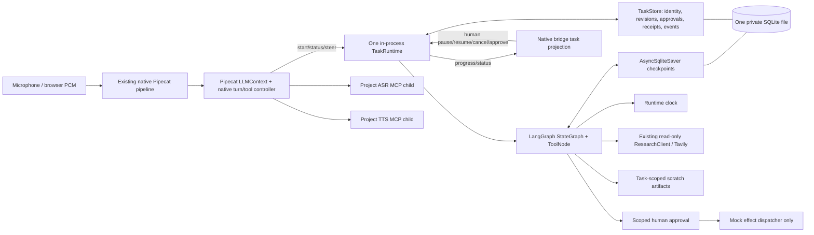

# Phase 5 — LangGraph task execution

**Status:** CONDITIONAL repository-local acceptance after independent review; bounded mock execution implemented; live task-model, real external-action, and physical Pi qualification pending. **Phase 2 remains `PENDING_OPERATOR_VALIDATION`.** This report covers only Phase 5. No Phase 6 work, Pi access, paid inference, public/external writes, commit, or remote push occurred.

## Architecture implemented



Pipecat remains the only live conversation and speech-interruption owner. Its existing context and tool loop expose only `start_task`, `task_status`, and `steer_task` to conversational tool calling. A delegated task runs as one named asyncio task in the same application process/event loop; it is not a new worker process. The direct browser control channel handles human `status`, `steer`, `pause`, `resume`, `cancel`, and `approve`. Voice interruption does not call task cancellation. Both project-owned ASR and TTS stdio MCP servers remain actual services behind their existing thin adapters.

LangGraph owns graph progression, message state, tool routing, safe control boundaries and resumable interrupt/checkpoint semantics. The co-located `TaskStore` is ME3-specific policy/state: task ID/request idempotency, revision CAS, durable progress, approval scope/expiry, effect receipt state, artifact metadata, and independent readback records. It shares the LangGraph saver connection and lock; both live in the same SQLite file. One aiosqlite worker thread services that file. There is no second agent loop, agent framework, task daemon, queue service, vector store, external broker or extra LLM. Legacy Session/Onit paths and defaults remain as rollback and were not migrated or deleted.

Current task tools are intentionally bounded: runtime date/time, existing search/retrieval/evidence functions, task-local artifact write/read, and a mock-only approval-gated external action. Shell, browser, GitHub publication, destructive operations and real external APIs are **not connected**. Artifact readback can verify bytes on disk; the mock receipt can verify a stored fixture receipt. Neither proves an external-world outcome or factual claim truth.

### Before / after responsibilities

| Previous path | Phase5 native path |
|---|---|
| Pipecat-native immediate conversation/read-only tools; task-like fixture actions routed to `MockTaskExecutor`; the separately selected legacy engine retains its Session/Onit path. | Pipecat still handles dialogue and immediate tools, and sends only start/status/steer to LangGraph. Native delegated multi-step tasks use the durable graph runtime. |
| No native persistent task identity/revision/approval/effect ledger or graph checkpoint recovery for delegated native work. | LangGraph checkpoints resumable task state; TaskStore owns task lifecycle/effect-safety records in the same SQLite file. Human control is distinct from model tool calls. |
| Speech turn cancellation and conversation context were already Pipecat-native; no coupling from voice barge-in to legacy task stop. | Same separation remains: Pipecat owns voice; tasks survive speech interruption and can be separately steered, paused or cancelled. |
| Legacy Session and Onit remain available when the legacy engine is selected. | Both remain unchanged as rollback. No Session, Onit, audio-sidecar or legacy code was removed in this phase. |

### Exact runtime and dependency versions

The installed and locked versions are `langgraph==1.2.20`, `langgraph-checkpoint-sqlite==3.1.3`, transitive `langgraph-checkpoint==4.3.1`, `langgraph-prebuilt==1.1.1`, `langchain-core==1.7.7`, `aiosqlite==0.22.1`, alongside existing `pipecat-ai==1.13.0` and OpenAI SDK. New direct dependencies are only LangGraph and its SQLite saver; `uv.lock` records the resolved transitive set. `uv lock --check` passed. The API use follows the official [LangGraph persistence](https://docs.langchain.com/oss/python/langgraph/persistence), [interrupt/HITL](https://docs.langchain.com/oss/python/langgraph/interrupts), and [SQLite saver](https://github.com/langchain-ai/langgraph/tree/main/libs/checkpoint-sqlite) interfaces. The installed saver source warns that SQLite write throughput is limited for high-write production workloads; ME3 currently permits one active task, but concurrent load and Pi suitability remain unmeasured.

The task model reuses the Phase 4 configured `openai/gpt-oss-120b` Groq-compatible chat-completions endpoint and shared live-request budget. No separate coding model or automatic fallback was added. Streaming tool fragments are assembled and JSON-validated before LangGraph dispatch; provider SDK retries and parallel tool calls are disabled. A local fake AsyncOpenAI stream verified fragmented function name/arguments and the selected Groq request options without a network call. It caught and fixed a duplicate `parallel_tool_calls` keyword that would otherwise have broken the live GPT-OSS request.

## Implemented ownership and safety

| Concern | Owner and behavior |
|---|---|
| Conversation, user turn, speech interruption, immediate tools | Pipecat native context/controller and NativeLLM. Session remains available only on the explicit legacy engine. |
| Long task plan/tool loop | LangGraph `StateGraph` with framework `ToolNode`; single active task, bounded model/tool calls, sequential tool policy. No custom planner/step loop. |
| Task identity and updates | TaskStore: unique idempotent request id, revisioned requirements, status/events and bounded progress projection. Human steering uses expected-revision compare-and-set. |
| Checkpoint and recovery | LangGraph `AsyncSqliteSaver` in the same database. On new runtime startup, interrupted active tasks become paused; resume is explicit. A model request interrupted before checkpoint may be repeated and remains counted against the task request budget. |
| Cancellation and pause | Explicit task controls; graph checks at safe boundaries. Speech interruption never cancels the background task. Cancel is cooperative while a non-interruptible provider/tool call is in flight. |
| Approval | Direct human control only; task/operation/revision/action/details fingerprint and 10-minute expiry are persisted. The task model and conversational model cannot approve. Steering revokes pending approvals. |
| External effect | Only mock dispatcher is wired. An operation ID derives from task ID + model tool-call ID. State transitions to `dispatching` before dispatch; receipt is stored/read back. On restart, a stranded `dispatching` operation becomes `unknown` and is never automatically replayed. This prevents unsafe retry; it does **not** guarantee exactly-once remote execution. |
| Verification | Independent artifact byte readback and mock receipt lookup; factual/source quote presence explicitly does not equal truth verification. Pending/unknown effects prevent success. |
| Result/progress delivery | Progress and status are projected to the native bridge UI; the conversation can query task status/result or apply a correction. There is no unsolicited spoken notification scheduler yet; deliver-at-pause voice narration is a remaining integration gate. |
| Persistence privacy | Default DB is `var/cache/task-runtime/tasks.sqlite`; private directory/file permissions are required (directory 0700, file 0600). Per-task scratch directories are 0700 and artifact files 0600. Symlinks, unsafe paths, stale revisions and oversized inputs fail closed. |

Approval resume waits for the preceding interrupting graph call to finish before rescheduling. This closes a reproduced race in which the task could report `waiting_approval` just before the initial graph job returned, causing an immediately submitted approval to be lost or overwritten. Relative artifact paths are normalized before the safety/containment check; a default benchmark path uncovered and fixed this issue.

## Files changed

| File | Change |
|---|---|
| `src/me3_voice/task_runtime.py` | LangGraph graph/tool binding; SQLite TaskStore/checkpoints; bounded research/artifact tools; task controls, revision fencing, approval/effect state, recovery, metrics and conversation tool schemas. |
| `src/me3_voice/native_app.py` | Create/close the runtime with native app resources; register conversational task tools; dispatch start/status/steer; forward task events. |
| `src/me3_voice/native_bridge.py` | Project durable task state, add direct human-control WebSocket commands/results, and render task controls. |
| `src/me3_voice/ui/dashboard.js` | Add pause/resume/cancel/approve/reject controls for active tasks and display control results. |
| `src/me3_voice/conversation_context.py` | Tell the conversation when to delegate and distinguish speech interruption from human task controls. |
| `tests/test_phase5_tasks.py` | Offline graph, restart, failure, approval, safety, streamed-tool, voice-concurrency and filesystem tests. |
| `scripts/benchmark_phase5_runtime.py` | Reproducible fixture task latency/checkpoint/event-loop/resource benchmark with hashes. |
| `scripts/configure_phase5_keys.py` | Hidden interactive setup for optional Groq/Tavily keys using existing private-file enforcement. |
| `scripts/prepare_phase5_live_pilot.py` | Select 1–4 existing Phase4 questions without sending requests. |
| `configs/phase5-live-backends.example.json`, `configs/phase5-live-runtime.example.json` | Explicit capped example configs; not used for live requests. |
| `pyproject.toml`, `uv.lock` | Add pinned LangGraph and SQLite saver dependencies; lock transitive packages. |
| `docs/architecture_modernization/MASTER_PLAN.md`, `PROGRESS.md`, `DECISIONS.md`, `BENCHMARKS.md`, `docs/PLAN.md`, this report | Record authorization, architecture decision, evidence, metrics, limitations and next gates. |

## Offline scenarios and results

`tests/test_phase5_tasks.py` covers the following with local SQLite and scripted models:

- Dynamic multi-step search → task artifact write → artifact readback → completion verification.
- Steering while a model call is delayed; old revision tool output is rejected and only the revised artifact is written.
- Safe-boundary pause/resume, task cancellation with pending approval, and conversational interaction while a task is still blocked.
- Runtime close/reopen over the same SQLite file; saved graph state is resumed and an interrupted model call remains charged.
- Scoped approval, expected-revision conflict, rejection, expiry, steering revocation, completion receipt replay without a second dispatch, and hard-cancel simulation after an effect enters `dispatching`.
- Restart changes a stranded dispatch to `unknown`, produces no second dispatcher call, and never reports the outcome verified.
- Model tool schemas expose no injected runtime state or unregistered capabilities; live task calls fail closed without backend authorization.
- Streamed fake Groq-compatible function fragments reassemble to a typed tool call; no provider request is issued.
- Native Pipecat conversation completes while the separate task model awaits release. Both actual project ASR/TTS MCP stdio child processes are discovered and used with mock upstream inference.
- Private SQLite/artifact permissions and relative task artifact-root behavior.

**Final full regression:** `PYTHONDONTWRITEBYTECODE=1 OPENBLAS_NUM_THREADS=1 OMP_NUM_THREADS=1 var/cache/venv/bin/python -m pytest -q --basetemp=var/scratch/pytest-phase5-qualification` — **575 passed, 1 warning, 219.67s**. The single warning is the installed Pipecat `AudioContextTTSService` deprecation. Focused Phase 5 + native entrypoint suite passed 30 tests after permission/path hardening; Phase 5 suite then passed 16 tests after the relative-path regression case. Changed-file Ruff, `uv lock --check`, and `node --check src/me3_voice/ui/dashboard.js` passed.

## Measured resources and latency

Reproduce with:

```bash
PYTHONPATH=src var/cache/venv/bin/python scripts/benchmark_phase5_runtime.py --samples 10
```

The result is `var/results/architecture_modernization/phase5-runtime.json`. Environment: CPython 3.13.9, x86_64 HPC; one warm-up excluded; 10 local tasks, each a fixture 3 model-call / 2 artifact-tool sequence; no provider requests; one benchmark process plus its aiosqlite thread. The measured run recorded:

| Metric | Value | Scope |
|---|---:|---|
| Task startup | 296 ms | Runtime/SQLite graph startup after Python imports; not cold application start. |
| Task elapsed p50 / p95 | 1.103 / 7.816 s | n=10, local fixture/model and artifact readback; one slow sample dominates the small-sample tail. |
| Checkpoint write p50 / p95 | 33.1 / 81.4 ms | n=290 saver writes over 10 tasks. |
| Event-loop lag p50 / p95 / max | 0.075 / 0.927 / 80.3 ms | 5 ms heartbeat, n=3,465; maximum is a single host/scheduler outlier. |
| Runtime RSS / PSS / swap | 102,604 / 84,947 KiB / 0 | Single benchmark process after workload. |
| CPU user / system | 0.453 / 0.262 s | Ten fixture task samples. |

These values are repository-local **mock** evidence, not a before/after comparison. Checkpoint timing is material relative to short mock tasks and 29 saver writes/task; do not extrapolate to cloud-task completion. No Pi ARM64 install, Pi CPU/RAM/headroom, task-under-live-voice p95, live Groq/Tavily latency or cost, acoustic performance, provider task success, or performance improvement has been measured. The actual MCP concurrency test verifies event-loop responsiveness behavior but is not a Pi resource benchmark.

The benchmark JSON carries UTC timestamp, parent Git HEAD, Python/platform, provider/model fixture identity, sample counts and source SHA256 hashes. The ME3 workspace has no usable project-local Git metadata in this environment and is untracked under the parent Git checkout; parent HEAD was `9338bc205420747988f8b2254cae37701c13488a`. No files were staged or committed. The machine-readable result records this boundary.

## Credentials and deferred Phase 4 live pilot

Environment presence was checked without displaying values. No usable keys were available in the selected process environment or the project's secure secret files. Required names for a small live pilot are:

- `ME3_LLM_API_KEY` — required for the Groq task/conversation model.
- `ME3_RESEARCH_TAVILY_API_KEY` — required only for live search; existing bounded original-source retrieval also uses network requests under the Tavily research allowance.
- `ME3_ASR_API_KEY` and `ME3_TTS_API_KEY` — configured service names for later live Deepgram speech validation; current pilot deliberately leaves ASR/TTS in mock mode, so these are not required for this pilot.

Secure interactive configuration on this HPC checkout (the prompts hide input; the helper creates a mode-0600 file only under ignored `var/cache/` and refuses overwrite):

```bash
PYTHONPATH=src var/cache/venv/bin/python scripts/configure_phase5_keys.py \
  --output var/cache/phase5-secrets.env --include-tavily
```

Do not put keys in command arguments, chat, Git, or logs. The existing 40-case Phase 4 evaluation remains unrun. A small manifest selected four existing cases (`P4-02`, `P4-11`, `P4-12`, `P4-17`) at `var/cache/phase5-live-pilot.json`; it records `PREPARED_NOT_EXECUTED` and **0** live requests. Example configurations cap the later evaluation at at most **12 Groq chat requests** and **8 Tavily research requests/credits**; ASR/TTS stay mock. These are call caps, not a USD estimate; exact spend depends on token/input volume and current provider prices, which were not validated. Execution still requires explicit user approval for these caps and a current price/balance check. No live request has been sent.

After approval only, copy `configs/phase5-live-backends.example.json` and `configs/phase5-live-runtime.example.json` to ignored `var/cache/` copies, review that their models/endpoints/limits are exactly as intended, then run the existing `scripts/evaluate_native_conversation.py --run-authorized-live` against the four-case manifest with the private secrets file and a fresh result path under `var/results/`. The `--run-authorized-live` flag itself is not permission.

## Remaining gates and rollback

- **Phase 2:** physical Pi audio routing, audible speaker reference, AEC, true acoustic barge-in, capture fault/EOF, CPU/RAM/swap and p50/p95 remain `PENDING_OPERATOR_VALIDATION`.
- **Phase 5 live/scale:** independent assessment of unfamiliar tasks, model/tool quality, task cost/latency, longer running jobs, restart of the full bridge process and exhaustive crash-window coverage remain unqualified. The independent review below adds actual SIGKILL tests at model and mock-dispatch windows; recovery reopens the persisted file in a new runtime.
- **Delivery:** tasks are visible in UI/status and results can be asked for conversationally. Spoken asynchronous delivery at conversational pauses, reconnect result acknowledgments/delivery cursors, and task announcement suppression during user speech remain unimplemented acceptance work.
- **External work:** only mock actions exist. Phase 6 must add a reviewed typed capability/permission registry, real approval scope and expiry policy, idempotency/reconciliation with external receipts, independent postconditions, retries/timeouts and safe rollback before any write integration. GitHub Pages may only be a later regression task, not a special-case workflow.
- **Pi deployment:** exact ARM64 wheel compatibility, package memory, SQLite persistence behavior on the deployed filesystem and systemd lifecycle remain unmeasured.

Rollback is immediate and additive: select the legacy engine (still default) to restore Session/Onit behavior. Native uses the opt-in engine and its task DB under ignored `var/cache/task-runtime/`; do not delete pending/unknown task/effect records or reset IDs to bypass an ambiguous action. No legacy code was removed. Do not switch default or remove Session/Onit/sidecar paths until physical, live-policy, task-control and restart qualification pass.

**Next phase recommendation:** stop at the Phase 5 checkpoint. Before Phase 6, review this runtime independently and decide whether the custom TaskStore policy surface is acceptably small; then complete an explicitly authorized live pilot or record a no-key wait state. Keep Phase 2 physical qualification separately pending. Do not start Phase 6 automatically.

## Independent review and corrective rework — 2026-11-10

This section supersedes the earlier repository-local acceptance claim: **CONDITIONAL**. The bounded offline runtime is implemented, but complete goal verification and unsolicited spoken delivery are not established. Source review found real races beyond the original 575-test evidence.

### Defects corrected

- Concurrent first use could initialize multiple saver connections/graphs. A startup mutex now serializes initialization, and use after close fails explicitly.
- Completion read task state before awaiting verification, then committed success without rechecking. Steering, pause, or cancel during verification could be overwritten. Completion now rechecks revision/status and commits under the TaskStore lock; revised work replans, cancellation/pause wins.
- Human control methods used several separate store transactions. A narrow control mutex now serializes those methods, independently of graph execution and speech. Graph-side commits still require their own state checks; the mutex alone is not revision fencing.
- Returning an approval interrupt could overwrite a newer human pause/cancel with waiting_approval. Removed that redundant status write: prepare_approval already owns its durable transition.
- A provider failure after a pause/cancel request could change status to failed. Exception transitions now preserve human control under the store lock.
- Two runtime instances could open the same database and mistake live work for crashed work. A nonblocking Linux flock on the database file now enforces one runtime owner. SIGKILL releases the lock through the OS. This is local process exclusion, not distributed database leadership; deployment filesystem lock behavior still requires Pi qualification.
- Removed an unused duplicate mock dispatcher and no-op control-binding helper. No framework, service, queue, or model was added. Existing automatic control-boundary interrupt/resume orchestration remains substantial custom policy code; it was not replaced during this correction.

### Failure injection and evidence

New deterministic tests hold execution during completion verification and approval checkpoint return, then issue human controls. A delayed model raises after human pause/cancel to check the exception path. Ten concurrent startup callers share one connection. A second runtime owner is rejected until the first closes.

`tests/phase5_process_worker.py` is an offline child-process fixture. The parent uses actual SIGKILL at two windows: while a model call is blocked after its durable budget debit, and while a mock effect is dispatching after approval. A new runtime opens the same file, runs SQLite integrity_check, explicitly resumes the task, and checks terminal status. The uncertain effect remains unknown and the replacement dispatcher is never called. This is actual child termination followed by runtime reopening in the test parent; a full browser/bridge service restart and every possible instruction-level crash window remain untested.

The original focused suite plus the first crash/concurrency additions passed 22 tests. Subsequent approval-return, provider-failure, and ownership cases are included in the final full regression recorded below. Existing real speech-MCP/native Pipecat concurrency coverage remains in that regression. It demonstrates responsiveness with a waiting mock task, not hard real-time scheduling under saturated CPU or Pi hardware.

### Latency investigation

The benchmark now preserves every task duration, every checkpoint-call duration, and checkpoint timings grouped by task. Two 50-task runs did not reproduce the historical 7.816s p95: p50/p95 were 1.024/1.154s and 0.898/1.064s, with maxima 1.195s and 1.155s. Raw records are phase5-review-runtime.json and phase5-review-runtime-final.json under var/results/architecture_modernization/. These runs overlapped offline regression activity, are not controlled performance comparisons, and predate the final ownership-lock change.

The workspace filesystem reports fuseblk. FULL SQLite commits and saver-lock waits are material; saver timing includes waiting/overlapping async calls, so summing them is not an exclusive wall-time decomposition. The original outlier's cause is **unresolved**: its old artifact lacks individual samples and stage attribution. Do not attribute it conclusively to storage, host scheduling, or LangGraph. No Pi inference or resource improvement is claimed. Final-source qualification uses phase5-review-qualified.json; metrics are recorded below after execution.

### Credentials and boundaries

Neither required key was present in the review process environment. var/cache/phase5-secrets.env and .env were absent. Existing Groq/Tavily configurations and the 12-Groq/8-Tavily deferred pilot remain unchanged; zero paid calls were issued. Use the masked interactive helper above to create the private secrets file; the evaluator must receive it through --secrets-file. The keys are not automatically loaded merely because the file exists.

### Remaining acceptance limits

- Artifact byte readback verifies storage consistency; it does not establish that the user's entire goal was fulfilled. Current succeeded means the implementation's readback gate passed, not independently measured general-purpose task success. Semantic/provider task evaluation remains pending.
- Spoken result delivery at conversational pauses and durable delivery acknowledgments remain missing. UI/status delivery is implemented.
- Cancellation/pause are cooperative at graph boundaries; an in-flight tool may finish after a request. Receipts preserve effects already dispatched. No claim of exactly-once execution or rollback of an external effect is made.
- Only mock external actions are connected. Permission confinement and real service idempotency/reconciliation remain Phase6 work, requiring separate authorization.
- One active task and shared SQLite persistence limit concurrency; all-history cache growth and per-boundary checkpoint overhead still need long-duration/Pi measurement. No performance superiority is established.
- Phase2 remains PENDING_OPERATOR_VALIDATION. Legacy default/Session/Onit rollback and both speech MCP services remain. No Phase6 implementation, remote push, paid inference, or Pi SSH occurred.

Review regression history: an intermediate full run passed585 tests before the ownership case. The first ownership-enabled full run produced585 passes and one failure in the old simulated-crash fixture: it closed private saver internals and set _closed manually without releasing the newly introduced OS lock. Updated that fixture to cancel the job and call the public close lifecycle. Actual SIGKILL fixtures require no special lock cleanup. Final regression results below supersede this fixture failure.

Final-source50-task benchmark (phase5-review-qualified.json): task p50/p95/max0.862/1.604/3.343s; checkpoint calls p50/p9528.5/56.1ms(n1,450); event-loop lag p50/p95/max0.326/1.003/80.5ms(n8,795); sampled RSS/PSS104,652/83,946KiB, swap0. Python3.13.9, x86_64, zero provider calls. Source hashes were checked against the final runtime/application/benchmark sources. The corrected test fixture does not change runtime sources. Historical7.816s tail remains unexplained; no improvement conclusion is justified.

Final independent-review qualification: **586 passed, 1 existing Pipecat deprecation warning, 242.82s**. Command: `PYTHONDONTWRITEBYTECODE=1 OPENBLAS_NUM_THREADS=1 OMP_NUM_THREADS=1 var/cache/venv/bin/python -m pytest -q --basetemp=var/scratch/pytest-phase5-review-release-final`. Changed-file Ruff passed. Machine record/source hashes: `var/results/architecture_modernization/phase5-independent-review.json`; final-source mock benchmark: `var/results/architecture_modernization/phase5-review-qualified.json`. Assessment remains **CONDITIONAL** for the explicitly documented verification/delivery/deployment gaps. No new dependencies or live calls.

## Credential readiness update — 2026-11-11

The user reports `var/cache/phase5-secrets.env` mode0600 and a local no-value validation returned true for `ME3_LLM_API_KEY` and `ME3_RESEARCH_TAVILY_API_KEY`. The same private loader confirmed both names are available; values are not recorded. No inference or search request has been sent. The user authorized the existing capped pilot if it remains free. Before execution, the operator still needs to confirm Groq is on its Free tier and Tavily pay-as-you-go is disabled; the local secret file cannot establish either account setting. Once confirmed, the next available action is to run the four prepared cases with the 12 Groq / 8 Tavily caps and independently review answers/sources. This is Phase4 live qualification supporting Phase5; a separate multi-step live task qualification remains needed for Phase5. Phase2 physical Pi/AEC gates remain pending.
